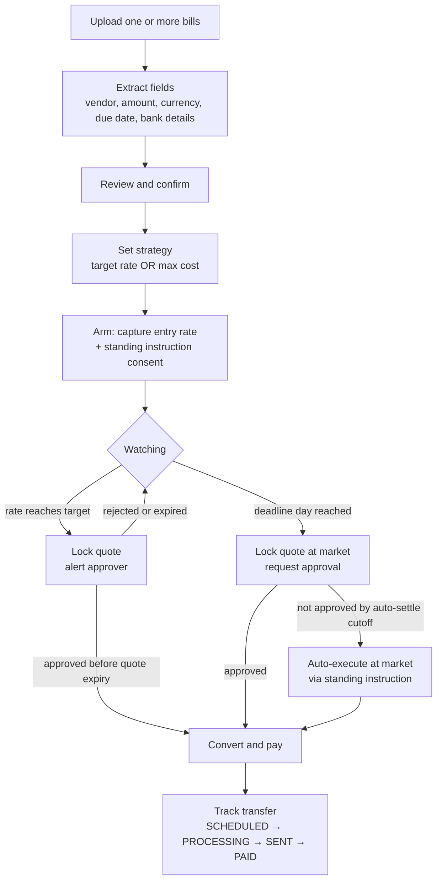

# 00 — Product Brief

## One-liner

A trading-terminal-style treasury tool that turns every foreign-currency bill into a **conditional FX order with a guaranteed expiry**: pay when the rate hits your target, or pay at market on the final safe day — never late.

## Problem

Finance teams paying foreign-currency invoices face a daily choice: convert now, or wait for a better rate. In practice they either:

- convert immediately on receipt (leaving savings on the table), or
- watch rates manually and risk forgetting until the due date (paying a bad rate, or paying late).

There is no simple "limit order with a deadline" for payables.

## Users

| Persona | Needs |
| --- | --- |
| **AP / Finance operator** (preparer) | Uploads bills, sets targets, monitors positions, reacts to alerts |
| **Approver** (finance lead / CFO) | Approves conversions quickly from an alert with a locked quote and a clear cost breakdown |

For the demo, one signed-in user holds both roles, with a role switcher so both sides of the flow can be shown.

## Core flow

## The perps-terminal metaphor

We use the metaphor deliberately, because it gives users a fast and familiar way to understand their FX exposure.

| Perps concept | FX Target Payment equivalent |
| --- | --- |
| Market (e.g. `ETH-PERP`) | Currency pair, `F/H` (e.g. `EUR/USD`) |
| Position | A bill (one bill = one position; many bills may share a market) |
| Position size | Bill amount in F |
| Entry price | Entry rate (indicative all-in rate when armed) |
| Limit order / take-profit line | Target rate line |
| Liquidation / expiry line | Execution deadline (vertical), due date (vertical) |
| Unrealized PnL | Savings vs entry, in H |
| Mark price | Current indicative rate |
| Order ticket panel | Bill ticket: strategy, amounts, deadline, approval |
| Positions / orders / history tabs | Active bills / awaiting approval / executed / activity log |
| Market switcher + watchlist | Bill list with sparklines, grouped by pair |
| Fill | Conversion booked + transfer created |

Unlike a real perp, there is **no leverage and no liquidation risk**. The "expiry" is a guarantee that the bill gets paid, not a loss event.

## Key product rules

1. **The deadline is sacred.** Every armed bill *will* be paid by its execution deadline, no matter what the rate does.
2. **Humans approve money movement.** Every payment path goes through an explicit approval. The only exception is the deadline auto-settle, which runs on a standing instruction the user explicitly consents to when arming the bill.
3. **Approvals see a locked price.** An approver never approves an indicative rate; they approve a quote with a visible expiry countdown.
4. **Everything is explainable.** Every state change is written to an activity log that is shown in the UI.

## Scope for the demo (in)

- Multi-bill upload (PDF/image), field extraction with a human review step
- Per-bill chart with entry, target, deadline and due-date lines; live ticking
- Target by **rate** or by **max cost**, both displaying the equivalent of the other
- Rate monitoring, target detection, quote locking, in-app alerts (toasts + notification centre; no email/Slack in the demo)
- Approval flow with a quote countdown; reject → keep watching
- Deadline-day approval request plus auto-settle at the cutoff
- Airwallex sandbox execution: quote → transfer (with conversion) → status tracking via webhooks
- **Demo mode**: market simulator and time controls so the full lifecycle can be shown in minutes

## Non-goals (demo)

- Multi-tenant org management, SSO, fine-grained RBAC
- Accounting / ERP sync (Airwallex Spend Bills sync is a stretch goal, see B-track)
- FX forwards / hedging products beyond a spot conversion paired with a transfer
- Payout-rail holiday calendars (the deadline math skips weekends and Airwallex's FX non-conversion days, but not local clearing holidays; lead days absorb them)
- Mobile-first layout (desktop terminal first; tablet is best effort)

## Success criteria for the demo

- A viewer understands the whole concept within 30 seconds of seeing the terminal.
- Full lifecycle for three bills shown live in under 5 minutes: one hits its target, one is rejected and re-armed, and one auto-settles on the deadline.
- Real Airwallex sandbox transfer IDs are visible, and statuses update through webhooks.
