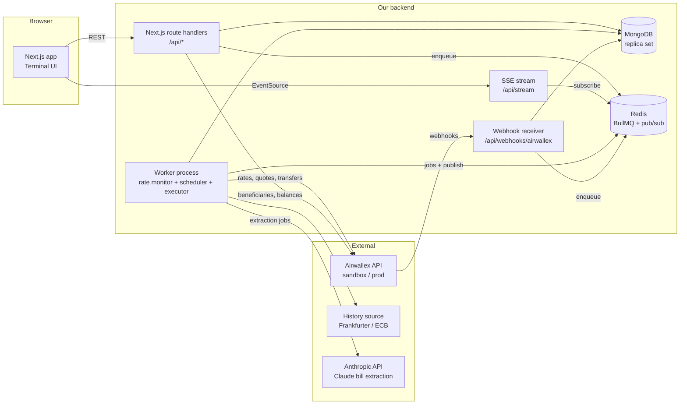
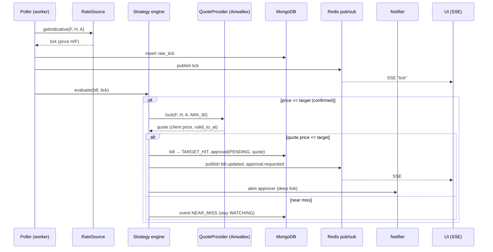
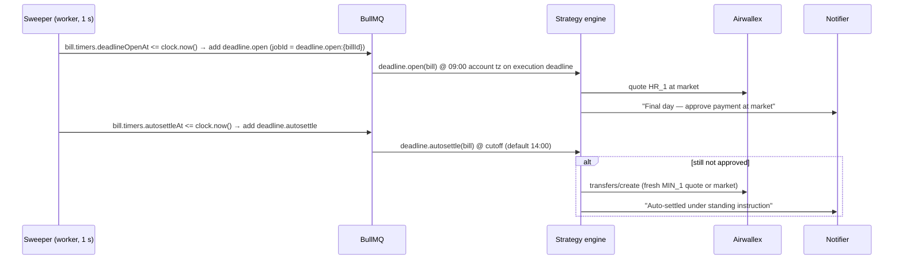

# 02 — Architecture

## 1. Runtime topology



- **Web (Next.js)** serves the UI and the REST API and holds the SSE connections. It is stateless.
- **Worker** is a long-running Node process started from the same repo. It runs the rate poller, the strategy engine, the deadline scheduler, the executor and the reconciler. It must not run on serverless.
- **MongoDB** (via Mongoose) is the single source of truth for bills, strategies, approvals, executions, events and rate ticks. Run it as a **replica set** (a single node is fine locally). Multi-document transactions require a replica set; the design mostly avoids needing them (see §9).
- **Redis** does two jobs:
  - **BullMQ** queues handle all background and retryable work: extraction, quote locking, execution, webhook processing, deadline actions, notifications.
  - **Redis pub/sub** (channel `app_events`) fans events from the worker and webhook handler out to every SSE connection.
- **Time-based triggers live in MongoDB, not in delayed jobs.** Deadline open, auto-settle cutoff and quote expiry are stored as timestamps on the bill or approval document. A 1-second **sweeper** in the worker queries for due items using the injected `Clock` and enqueues BullMQ jobs with deterministic `jobId`s. This works identically under the demo's warp clock, survives restarts (catch-up is automatic), and keeps the timers visible in the database. See §9.
- **Adapters** isolate every external dependency behind an interface. Each one has a `mock` implementation so the UI track and tests never need credentials.

## 2. Stack (defaults; see [09](./09-decisions-and-open-questions.md))

| Layer | Choice | Why |
| --- | --- | --- |
| Language | TypeScript (strict) everywhere | One type system from DB to UI |
| Web framework | Next.js (App Router) | Pages + route handlers in one deployable |
| Styling | Tailwind CSS v4 + CSS variables for tokens | Fast iteration, tokens map cleanly to the design system |
| Primitives | Radix UI (headless) | Accessible dialogs, popovers, tabs, tooltips |
| Motion | Motion (formerly Framer Motion) | Number transitions, layout animations |
| Page ground | `@paper-design/shaders-react` `GrainGradient`, pinned `0.0.81` | Bottom grain aurora behind the sheet (D-22) |
| Extraction progress | `thinking-orbs` (`ThinkingOrb`) | The extraction row, instead of a generic spinner (D-21) |
| Charts | TradingView **Lightweight Charts** v5 | Trading-grade performance. Price lines built in; vertical lines and zones through series primitives (plugins) |
| Client state | TanStack Query (server state) + Zustand (UI state: selected bill, layout) | Clear split |
| Validation / contracts | zod | Shared request/response schemas, runtime validation |
| Database / ODM | MongoDB 7+ (replica set) + **Mongoose** | Flexible documents for extraction output and raw Airwallex payloads; time-series collections for rate ticks |
| Queue | **BullMQ** on **Redis 7** | Retries with backoff, concurrency limits, deterministic `jobId` dedupe, repeatable jobs |
| Event fan-out | Redis pub/sub | Worker/webhook → all SSE connections, across multiple web instances |
| Realtime | Server-Sent Events | One-way stream is enough, and it is simple |
| Decimal math | `decimal.js` (never JS floats for money/rates) | Currency precision correctness |
| Dates | `date-fns` + `date-fns-tz` | Account-time-zone deadline math |
| Bill extraction | Deterministic readers (e-invoice XML, payment QR, text layer) + **Claude** (Anthropic API, structured outputs) behind `BillExtractor`; optional local Ollama adapter | PDF/image → validated fields with confidence and highlights. See [12](./12-bill-extraction.md) |
| Notifications | In-app only (SSE `notification` → toasts + `NotificationCenter`) | Demo scope: no out-of-band channel (Q-05) |
| Testing | Vitest (unit), Playwright (e2e + visual snapshots of `/dev/ui-kit`) | |
| Package manager | pnpm | |
| Local infra | Docker Compose (MongoDB single-node replica set + Redis), cloudflared/ngrok tunnel for webhooks | |

## 3. Repository layout

```
/
├─ docs/                          # this documentation
├─ src/
│  ├─ app/                        # Next.js App Router
│  │  ├─ (terminal)/              # main terminal route group
│  │  │  ├─ page.tsx              # /            → terminal
│  │  │  └─ bills/[id]/page.tsx   # /bills/:id   → deep link (same layout, selected)
│  │  ├─ upload/                  # upload + review flow (modal route + full page fallback)
│  │  ├─ settings/
│  │  ├─ dev/
│  │  │  ├─ ui-kit/page.tsx       # UI kit review page (dev only)
│  │  │  └─ market/page.tsx       # demo control room (simulator + time controls)
│  │  └─ api/
│  │     ├─ bills/...             # REST
│  │     ├─ approvals/...
│  │     ├─ uploads/...
│  │     ├─ stream/route.ts       # SSE
│  │     ├─ webhooks/airwallex/route.ts
│  │     └─ demo/...              # demo-mode controls (guarded)
│  ├─ ui/                         # UI KIT (U track) — no data fetching inside
│  │  ├─ tokens/                  # CSS variables, tailwind theme
│  │  ├─ primitives/              # Button, Input, Badge, ...
│  │  ├─ trading/                 # PriceTicker, PnLCell, CountdownChip, ...
│  │  ├─ chart/                   # FxChart + primitives (lines, zones, markers)
│  │  └─ patterns/                # BillTicket, ApprovalCard, PositionsTable, ...
│  ├─ features/                   # page-level composition + data hooks (U6/U7)
│  ├─ contracts/                  # zod schemas + TS types shared FE/BE (source of truth)
│  ├─ mocks/                      # fixtures + mock adapters + simulated market (FE-usable)
│  ├─ server/                     # B track
│  │  ├─ db/                      # mongoose connection, models/, repositories, index sync
│  │  ├─ domain/                  # state machine, rate math, strategy engine (pure)
│  │  ├─ adapters/
│  │  │  ├─ airwallex/            # client, auth, endpoints, webhook verify
│  │  │  ├─ rates/                # RateSource: airwallex | simulated
│  │  │  ├─ history/              # HistorySource: frankfurter | none
│  │  │  ├─ extraction/           # BillExtractor: anthropic | ollama | mock (pipeline in 12 §6)
│  │  │  └─ notify/               # Notifier: inapp (the only implementation; Q-05)
│  │  ├─ services/                # use-cases: armBill, approve, execute, ...
│  │  ├─ queue/                   # BullMQ queues, job names, typed payloads, Redis connection
│  │  └─ events/                  # event bus (Redis pub/sub) + SSE serializer
│  └─ worker/
│     ├─ index.ts                 # entry: pnpm worker (starts BullMQ workers + loops)
│     ├─ poller.ts
│     ├─ sweeper.ts               # 1 s loop: due timers in Mongo → BullMQ jobs
│     ├─ processors/              # one file per BullMQ queue
│     ├─ executor.ts
│     ├─ reconciler.ts
│     └─ demoSim.ts               # demo only: Simulate runs (scripted ticks, auto-approve, transfer advance)
├─ scripts/                       # seeds, smoke tests, index sync, migrations (migrate-mongo)
├─ docker-compose.yml
└─ .env.example
```

**Boundary rules**
- `src/ui/**` must not import from `src/server/**`, `src/features/**` or any data library. It takes props only. This keeps the UI kit reviewable in isolation.
- `src/server/domain/**` is pure (no I/O), so it is fully unit-testable.
- `src/contracts/**` is the only thing both sides import.

## 4. Adapters (ports)

```ts
interface RateSource {
  getIndicative(input: { buy: Ccy; sell: Ccy; buyAmount: Decimal; conversionDate?: string }): Promise<RateTick>;
}
interface QuoteProvider {
  lock(input: { buy: Ccy; sell: Ccy; buyAmount: Decimal; validity: QuoteValidity }): Promise<LockedQuote>;
}
interface PaymentsGateway {
  createTransfer(input: CreateTransferInput): Promise<TransferRef>;
  cancelTransfer(id: string): Promise<void>;
  getTransfer(id: string): Promise<TransferSnapshot>;
  getBalances(): Promise<Balance[]>;
  upsertBeneficiary(input: BeneficiaryInput): Promise<BeneficiaryRef>;
}
interface HistorySource { getDaily(pair: Pair, from: Date, to: Date): Promise<Candle[]> }
interface BillExtractor { extract(file: UploadedFile): Promise<ExtractedBill> }
interface Notifier { send(n: Notification): Promise<void> }
interface Clock { now(): Date }   // demo mode swaps this for a time-warp clock
```

Adapters are selected by environment:

| Env var | Values | Default |
| --- | --- | --- |
| `RATE_SOURCE` | `airwallex` \| `simulated` | `simulated` in demo mode |
| `PAYMENTS_GATEWAY` | `airwallex` \| `mock` | `airwallex` (sandbox) |
| `HISTORY_SOURCE` | `frankfurter` \| `none` \| `simulated` | `frankfurter` |
| `BILL_EXTRACTOR` | `anthropic` \| `ollama` \| `mock` | `anthropic` |
| `CLOCK` | `system` \| `warp` | `system` |
| `DEADLINE_SAFETY_NET` | `none` \| `airwallex` | `none` |

**Hybrid demo mode** (recommended for the live demo): `RATE_SOURCE=simulated`, `PAYMENTS_GATEWAY=airwallex`. The simulated market drives the chart and triggers, while quotes and transfers are real sandbox calls. The approval card shows both the simulated trigger rate and the real Airwallex quote rate, and we are transparent that the market feed is simulated. Because a real quote won't follow a simulated price, the quote check compares the simulated price for simulated ticks ([03 §3](./03-domain-model.md#3-trigger-rules)). See [08](./08-demo-plan.md).

**Per-bill simulation (Simulate button):** the poller reads rates through a `RoutingRateSource`. A bill with an active `demo:sim:{billId}` key in Redis gets scripted simulated ticks from the worker's `demoSim` loop, and every other bill gets the configured source. This lets the demo run on the live feed and still produce an on-demand target hit for one bill. See [08 §1.1](./08-demo-plan.md#11-simulate-button).

## 5. Key runtime flows

### 5.1 Tick → trigger → quote → alert



### 5.2 Approve → execute → settle

```mermaid
sequenceDiagram
  participant UI
  participant API as /api/approvals/:id/approve
  participant DB as MongoDB
  participant Q as BullMQ (Redis)
  participant EX as Executor (worker)
  participant AWX as Airwallex
  participant WH as /api/webhooks/airwallex

  UI->>API: approve (approval_id)
  API->>DB: conditional update: bill {state: TARGET_HIT, version: v} → APPROVED (quote not expired)
  API->>Q: add execute job (jobId = execute:{billId}:{attempt})
  Q->>EX: execute
  EX->>AWX: GET balances/current (check H >= est. cost)
  EX->>AWX: POST transfers/create {quote_id, request_id=tr:bill:attempt}
  AWX-->>EX: transfer (SCHEDULED/PROCESSING)
  EX->>DB: execution doc, bill → EXECUTING → IN_FLIGHT
  AWX-->>WH: payout.transfer.processing / sent / paid
  WH->>DB: verify HMAC, insert webhook_event (_id = event id; duplicate → skip)
  WH->>Q: add webhook.process job
  Q->>EX: apply status (monotonic) → publish bill.updated → SSE
```

### 5.3 Deadline day



## 6. Realtime events (SSE)

A single stream at `/api/stream` carries all events. Clients filter by `billId`.

| Event | Payload | Emitted when |
| --- | --- | --- |
| `tick` | `{ pair, billId?, ts, price, source }` | A new rate tick is stored |
| `bill.updated` | `BillSummary` | Any bill field or state change |
| `approval.requested` | `Approval` | A target hit or the deadline window opens |
| `approval.resolved` | `{ approvalId, outcome }` | Approved, rejected or expired |
| `execution.updated` | `Execution` | Transfer status changed |
| `notification` | `Notification` | Something should be toasted |
| `clock` | `{ now, warp }` | Demo mode only |
| `demo.sim` | `{ billId, simId, phase: 'RAMPING'\|'TRIGGERED'\|'AUTO_APPROVED'\|'EXECUTING'\|'SETTLING'\|'DONE'\|'ABORTED', etaSec? }` | Demo mode only: Simulate run progress |

## 7. Security (demo-appropriate)

- Airwallex credentials stay server-side only (`AIRWALLEX_CLIENT_ID`, `AIRWALLEX_API_KEY`). Use a **scoped** key with only these scopes: FX rates/quotes/conversions, transfers, beneficiaries, balances, and files (plus spend if the stretch goal is taken).
- Webhook receiver: verify the HMAC over the **raw** body before parsing, and reject timestamps older than 5 minutes.
- Approve/reject endpoints require an authenticated session with the `approver` role (the demo uses a simple session with a role switcher).
- The `/dev/*` and `/api/demo/*` routes are disabled unless `DEMO_MODE=true`.
- Store vendor bank details encrypted at rest, or keep them only in Airwallex (we store just `beneficiary_id` plus masked display fields).

## 8. Environment variables

```bash
# Airwallex
AIRWALLEX_ENV=sandbox                     # sandbox | production
AIRWALLEX_BASE_URL=https://api.sandbox.airwallex.com
AIRWALLEX_FILES_BASE_URL=https://files.sandbox.airwallex.com   # verify host in sandbox
AIRWALLEX_CLIENT_ID=
AIRWALLEX_API_KEY=
AIRWALLEX_LOGIN_AS=                       # optional account id when key spans accounts
AIRWALLEX_API_VERSION=2026-08-21
AIRWALLEX_WEBHOOK_SECRET=
AIRWALLEX_ACCOUNT_TZ=America/Los_Angeles  # AWX US entity; must match onboarding entity (Q-01)
AIRWALLEX_GLOBAL_ACCOUNT_ID=              # sandbox Global Account in H, for deposit simulation (V13)

# App
MONGODB_URI=mongodb://localhost:27017/fxtarget?replicaSet=rs0&directConnection=true
REDIS_URL=redis://localhost:6379
HOME_CURRENCY=USD
DEMO_MODE=true
NEXT_PUBLIC_DATA_SOURCE=api               # mock | api (build-time; mock runs the UI with no backend)
RATE_SOURCE=simulated
PAYMENTS_GATEWAY=airwallex
HISTORY_SOURCE=frankfurter
BILL_EXTRACTOR=anthropic                  # anthropic | ollama | mock (see 12 §4)
CLOCK=warp
DEADLINE_SAFETY_NET=none

# Strategy defaults
POLL_INTERVAL_MS=10000
TRIGGER_CONFIRM_TICKS=2
TRIGGER_BUFFER_BPS=0
QUOTE_VALIDITY_TARGET=MIN_30
QUOTE_VALIDITY_DEADLINE=HR_1
DEADLINE_WINDOW_OPEN=09:00               # account tz (Q-07)
DEADLINE_AUTOSETTLE_CUTOFF=14:00
RATE_TICKS_TTL_DAYS=30                   # 7 on Atlas M0 (10 §5.2)

# Integrations
ANTHROPIC_API_KEY=                        # worker only
EXTRACTION_MODEL=claude-haiku-4-5
EXTRACTION_MODEL_STRONG=claude-sonnet-5   # escalation for scans / low confidence
EXTRACTION_MAX_PAGES=3
OLLAMA_URL=                               # optional local adapter
OLLAMA_MODEL=
```

## 9. MongoDB + Redis conventions

### 9.1 Why Redis is needed

MongoDB has no built-in job queue or cross-process push. Without Redis we would have to build retries, concurrency limits and fan-out on top of polling or change streams. With Redis:

| Need | Solution |
| --- | --- |
| Retryable background work (extraction, execution, webhook processing, notifications) | BullMQ queues with exponential backoff |
| Exactly-one execution job per bill attempt | BullMQ deterministic `jobId` (a duplicate `add` is a no-op) |
| Realtime fan-out to all SSE connections (and multiple web instances) | Redis pub/sub channel `app_events` |
| Shared Airwallex rate limiter across worker concurrency | Token bucket in Redis (`INCR` + `PEXPIRE`), or BullMQ's queue-level `limiter` |
| Airwallex token cache shared across processes (optional) | Redis key `awx:token` with TTL = `expires_at − 60 s` |

### 9.2 Queues (`src/server/queue`)

| Queue | Producer | Concurrency | `jobId` | Retries |
| --- | --- | --- | --- | --- |
| `extraction` | `POST /api/uploads` | 4 | `extract:{documentId}` | 3, exp 5 s |
| `strategy` | poller (on trigger) | 4 | `trigger:{billId}:{tickId}` | 2 |
| `deadline` | sweeper | 2 | `deadline.open:{billId}`, `deadline.autosettle:{billId}` | 5, exp 10 s |
| `quote-expiry` | sweeper | 4 | `quote-expiry:{approvalId}` | 3 |
| `execution` | approve API, autosettle | 2 | `execute:{billId}:{attempt}` | 5, exp 2 s (same `request_id`) |
| `webhook` | webhook route | 4 | `webhook:{eventId}` | 10, exp 5 s |
| `notify` | services | 4 | `notify:{notificationId}` | 5 |
| `reconcile` | repeatable job, every 60 s | 1 | repeatable | — |

The poller is a plain loop inside the worker, not a queue, so tick timing stays predictable.

### 9.3 Consistency without row locks

MongoDB updates on a single document are atomic. Every bill state change is one **conditional update** on the bill document:

```ts
Bill.findOneAndUpdate(
  { _id: billId, state: { $in: allowedFrom }, version: expectedVersion },
  { $set: { state: to, ...patch }, $inc: { version: 1 }, $push: { recentEvents: { $each: [evt], $slice: -20 } } },
  { new: true },
);
// null → lost the race → reload and re-evaluate (or return INVALID_STATE)
```

- A `version` field provides optimistic concurrency. Mongoose's `optimisticConcurrency: true` is enabled on the `Bill` schema for `save()` paths as well.
- The full audit event is also inserted into `bill_events`. If that insert fails, the transition still stands and the event is retried from a BullMQ job; the activity log is eventually consistent.
- **Multi-document transactions** (a replica set is required) are used in exactly two places where two documents must change together:
  - approve: the approval `PENDING → APPROVED` + the bill `TARGET_HIT|DEADLINE_WINDOW → APPROVED`
  - execution create: the execution doc + the bill `APPROVED|AUTO_SETTLING → EXECUTING`
- Duplicate-execution guard: a **partial unique index** on `executions { billId: 1 }` where `{ active: true }`. Executions set `active: false` when they reach `FAILED`/`CANCELLED`.

### 9.4 Money in MongoDB

- Money and rate fields are `Schema.Types.Decimal128`. They are converted to and from `decimal.js` at the repository boundary, never exposed as numbers.
- A shared Mongoose plugin adds a `toJSON` transform that renders every `Decimal128` as a string, matching the contracts.

### 9.5 Local infrastructure

```yaml
# docker-compose.yml (sketch)
services:
  mongo:
    image: mongo:7
    command: ["--replSet", "rs0", "--bind_ip_all"]
    ports: ["27017:27017"]
    healthcheck:
      test: ["CMD", "mongosh", "--quiet", "--eval", "try { rs.status().ok } catch (e) { rs.initiate({_id:'rs0',members:[{_id:0,host:'localhost:27017'}]}).ok }"]
      interval: 5s
      retries: 20
  redis:
    image: redis:7
    ports: ["6379:6379"]
```

A hosted option for the demo is MongoDB Atlas (free tier is a replica set) + Upstash or Redis Cloud. BullMQ needs a Redis that supports blocking commands, which rules out HTTP-only Redis APIs.

**Production/demo hosting** (web + worker + Redis on one server behind Caddy, MongoDB on Atlas) is specified in [10 — Deployment](./10-deployment.md).
