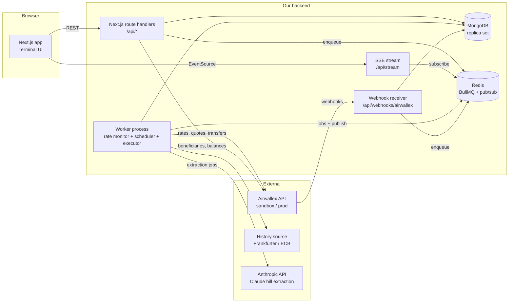
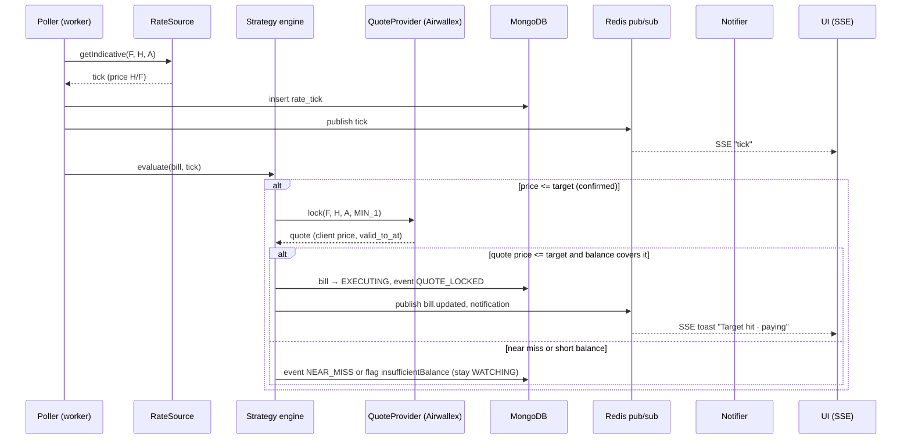
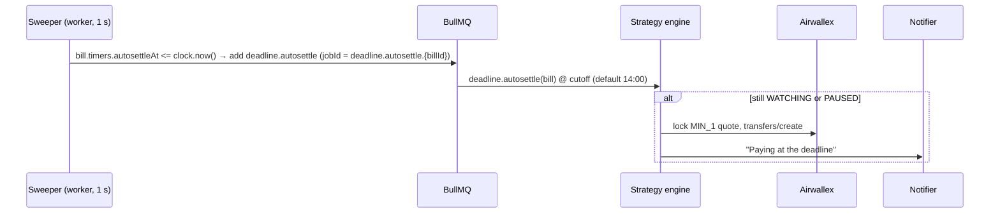

# 02 — Architecture

## 1. Runtime topology



- **Web (Next.js)** serves the UI and the REST API and holds the SSE connections. It is stateless.
- **Worker** is a long-running Node process started from the same repo. It runs the rate poller, the strategy engine, the deadline scheduler, the executor and the reconciler. It must not run on serverless.
- **MongoDB** (via Mongoose) is the single source of truth for bills, strategies, executions, events and rate ticks. Run it as a **replica set** (a single node is fine locally). Multi-document transactions require a replica set; the design mostly avoids needing them (see §9).
- **Redis** does two jobs:
  - **BullMQ** queues handle all background and retryable work: extraction, quote locking, execution, webhook processing, deadline actions, notifications.
  - **Redis pub/sub** (channel `app_events`) fans events from the worker and webhook handler out to every SSE connection.
- **Time-based triggers live in MongoDB, not in delayed jobs.** The deadline cutoff is stored as a timestamp on the bill. A 1-second **sweeper** in the worker queries for due items using the injected `Clock` and enqueues BullMQ jobs with deterministic `jobId`s. This works identically under the demo's warp clock, survives restarts (catch-up is automatic), and keeps the timers visible in the database. See §9.
- **Adapters** isolate every external dependency behind an interface. Each one has a `mock` implementation so the UI track and tests never need credentials.

## 2. Stack (defaults; see [09](./09-decisions-and-open-questions.md))

| Layer | Choice | Why |
| --- | --- | --- |
| Language | TypeScript (strict) everywhere | One type system from DB to UI |
| Web framework | Next.js (App Router) | Pages + route handlers in one deployable |
| Styling | Tailwind CSS v4 + CSS variables for tokens | Fast iteration, tokens map cleanly to the design system |
| Primitives | Radix UI (headless) | Accessible dialogs, popovers, tabs, tooltips |
| Motion | Motion (formerly Framer Motion) | Number transitions, layout animations |
| Page ground | `@paper-design/shaders-react` `GrainGradient`, pinned `0.0.81` | Bottom grain aurora behind the sheet (D-22) |
| Extraction progress | `thinking-orbs` (`ThinkingOrb`) | The extraction row, instead of a generic spinner (D-21) |
| Charts | TradingView **Lightweight Charts** v5 | Trading-grade performance. Price lines built in; vertical lines and zones through series primitives (plugins) |
| Client state | TanStack Query (server state) + Zustand (UI state: selected bill, layout) | Clear split |
| Validation / contracts | zod | Shared request/response schemas, runtime validation |
| Database / ODM | MongoDB 7+ (replica set) + **Mongoose** | Flexible documents for extraction output and raw Airwallex payloads; time-series collections for rate ticks |
| Queue | **BullMQ** on **Redis 7** | Retries with backoff, concurrency limits, deterministic `jobId` dedupe, repeatable jobs |
| Event fan-out | Redis pub/sub | Worker/webhook → all SSE connections, across multiple web instances |
| Realtime | Server-Sent Events | One-way stream is enough, and it is simple |
| Decimal math | `decimal.js` (never JS floats for money/rates) | Currency precision correctness |
| Dates | `date-fns` + `date-fns-tz` | Account-time-zone deadline math |
| Bill extraction | Deterministic readers (e-invoice XML, payment QR, text layer) + **Claude** (Anthropic API, structured outputs) behind `BillExtractor`; optional local Ollama adapter | PDF/image → validated fields with confidence and highlights. See [12](./12-bill-extraction.md) |
| Notifications | In-app only (SSE `notification` → toasts + `NotificationCenter`) | Demo scope: no out-of-band channel (Q-05) |
| Testing | Vitest (unit), Playwright (e2e + visual snapshots of `/dev/ui-kit`) | |
| Package manager | pnpm | |
| Local infra | Docker Compose (MongoDB single-node replica set + Redis), cloudflared/ngrok tunnel for webhooks | |

## 3. Repository layout

```
/
├─ docs/                          # this documentation
├─ src/
│  ├─ app/                        # Next.js App Router
│  │  ├─ (terminal)/              # main terminal route group
│  │  │  ├─ page.tsx              # /            → terminal
│  │  │  └─ bills/[id]/page.tsx   # /bills/:id   → deep link (same layout, selected)
│  │  ├─ upload/                  # upload + review flow (modal route + full page fallback)
│  │  ├─ settings/
│  │  ├─ dev/
│  │  │  ├─ ui-kit/page.tsx       # UI kit review page (dev only)
│  │  │  └─ market/page.tsx       # demo control room (simulator + time controls)
│  │  └─ api/
│  │     ├─ bills/...             # REST
│  │     ├─ uploads/...
│  │     ├─ stream/route.ts       # SSE
│  │     ├─ webhooks/airwallex/route.ts
│  │     └─ demo/...              # demo-mode controls (guarded)
│  ├─ ui/                         # UI KIT (U track) — no data fetching inside
│  │  ├─ tokens/                  # CSS variables, tailwind theme
│  │  ├─ primitives/              # Button, Input, Badge, ...
│  │  ├─ trading/                 # PriceTicker, PnLCell, CountdownChip, ...
│  │  ├─ chart/                   # FxChart + primitives (lines, zones, markers)
│  │  └─ patterns/                # BillTicket, PositionsTable, ...
│  ├─ features/                   # page-level composition + data hooks (U6/U7)
│  ├─ contracts/                  # zod schemas + TS types shared FE/BE (source of truth)
│  ├─ mocks/                      # fixtures + mock adapters + simulated market (FE-usable)
│  ├─ server/                     # B track
│  │  ├─ db/                      # mongoose connection, models/, repositories, index sync
│  │  ├─ domain/                  # state machine, rate math, strategy engine (pure)
│  │  ├─ adapters/
│  │  │  ├─ airwallex/            # client, auth, endpoints, webhook verify
│  │  │  ├─ rates/                # RateSource: airwallex | simulated
│  │  │  ├─ history/              # HistorySource: frankfurter | none
│  │  │  ├─ extraction/           # BillExtractor: anthropic | ollama | mock (pipeline in 12 §6)
│  │  │  └─ notify/               # Notifier: inapp (the only implementation; Q-05)
│  │  ├─ services/                # use-cases: armBill, execute, ...
│  │  ├─ queue/                   # BullMQ queues, job names, typed payloads, Redis connection
│  │  └─ events/                  # event bus (Redis pub/sub) + SSE serializer
│  └─ worker/
│     ├─ index.ts                 # entry: pnpm worker (starts BullMQ workers + loops)
│     ├─ poller.ts
│     ├─ sweeper.ts               # 1 s loop: due timers in Mongo → BullMQ jobs
│     ├─ processors/              # one file per BullMQ queue
│     ├─ executor.ts
│     ├─ reconciler.ts
│     └─ demoSim.ts               # demo only: Simulate runs (scripted ticks, transfer advance)
├─ scripts/                       # seeds, smoke tests, index sync, migrations (migrate-mongo)
├─ docker-compose.yml
└─ .env.example
```

**Boundary rules**
- `src/ui/**` must not import from `src/server/**`, `src/features/**` or any data library. It takes props only. This keeps the UI kit reviewable in isolation.
- `src/server/domain/**` is pure (no I/O), so it is fully unit-testable.
- `src/contracts/**` is the only thing both sides import.

## 4. Adapters (ports)

```ts
interface RateSource {
  getIndicative(input: { buy: Ccy; sell: Ccy; buyAmount: Decimal; conversionDate?: string }): Promise<RateTick>;
}
interface QuoteProvider {
  lock(input: { buy: Ccy; sell: Ccy; buyAmount: Decimal; validity: QuoteValidity }): Promise<LockedQuote>;
}
interface PaymentsGateway {
  createTransfer(input: CreateTransferInput): Promise<TransferRef>;
  cancelTransfer(id: string): Promise<void>;
  getTransfer(id: string): Promise<TransferSnapshot>;
  getBalances(): Promise<Balance[]>;
  upsertBeneficiary(input: BeneficiaryInput): Promise<BeneficiaryRef>;
}
interface HistorySource { getDaily(pair: Pair, from: Date, to: Date): Promise<Candle[]> }
interface BillExtractor { extract(file: UploadedFile): Promise<ExtractedBill> }
interface Notifier { send(n: Notification): Promise<void> }
interface Clock { now(): Date }   // demo mode swaps this for a time-warp clock
```

Adapters are selected by environment:

| Env var | Values | Default |
| --- | --- | --- |
| `RATE_SOURCE` | `airwallex` \| `simulated` | `airwallex` in the demo. Unset falls back to `simulated` |
| `PAYMENTS_GATEWAY` | `airwallex` \| `mock` | `airwallex` (sandbox) |
| `HISTORY_SOURCE` | `frankfurter` \| `none` \| `simulated` | `frankfurter` |
| `BILL_EXTRACTOR` | `anthropic` \| `ollama` \| `mock` | `anthropic` |
| `CLOCK` | `system` \| `warp` | `system` |
| `DEADLINE_SAFETY_NET` | `none` \| `airwallex` | `none` |

**Demo feed:** `RATE_SOURCE=airwallex`, `PAYMENTS_GATEWAY=airwallex`. The poller reads sandbox `rates/current` for every bill that is not in a Simulate run. Quotes and transfers are real sandbox calls. A bill's chart reads Simulated only when that bill has a recorded simulation (`RUNNING` or `TRIGGERED`). `RATE_SOURCE=simulated` remains for offline development and the in-browser mock: the shared walk drives every bill, and the top bar reads Simulated. A simulated tick still compares the simulated price with the target, because a sandbox quote will not follow it ([03 §3](./03-domain-model.md#3-trigger-rules)). See [08](./08-demo-plan.md).

**Per-bill simulation (Simulate button):** the worker reads rates through a `RoutingRateSource`. A bill with an active `demo:sim:{billId}` key is left out of the shared poll. The `demoSim` loop writes that bill's ticks through `RoutingRateSource` every wall-clock second, and every other bill keeps the configured source. Clock changes and market nudges are Redis records (`demo:clock`, `demo:market`) because the API and the worker are separate processes. See [08 §1.1](./08-demo-plan.md#11-simulate-button).

## 5. Key runtime flows

### 5.1 Tick → trigger → quote → alert



### 5.2 Execute → settle

The strategy job (or the cutoff job) has already moved the bill to `EXECUTING` and holds a quote that is still valid.

```mermaid
sequenceDiagram
  participant Q as BullMQ (Redis)
  participant EX as Executor (worker)
  participant DB as MongoDB
  participant AWX as Airwallex
  participant WH as /api/webhooks/airwallex

  Q->>EX: execute (jobId = execute.{billId}.{attempt})
  EX->>AWX: GET balances/current (check H >= est. cost)
  EX->>AWX: POST transfers/create {quote_id, request_id=tr:bill:attempt}
  AWX-->>EX: transfer (SCHEDULED/PROCESSING)
  EX->>DB: execution doc, bill → IN_FLIGHT
  AWX-->>WH: payout.transfer.processing / sent / paid
  WH->>DB: verify HMAC, insert webhook_event (_id = event id; duplicate → skip)
  WH->>Q: add webhook.process job
  Q->>EX: apply status (monotonic) → publish bill.updated → SSE
```

### 5.3 Deadline cutoff



## 6. Realtime events (SSE)

A single stream at `/api/stream` carries all events. Clients filter by `billId`.

| Event | Payload | Emitted when |
| --- | --- | --- |
| `tick` | `{ pair, billId?, simId?, ts, price, source }` | A new rate tick is stored. `simId` marks a Simulate session and is applied only to that bill |
| `bill.updated` | `BillSummary` | Any bill field or state change |
| `execution.updated` | `Execution` | Transfer status changed |
| `notification` | `Notification` | Something should be toasted |
| `hello` | `{ feed: 'AIRWALLEX'\|'SIMULATED', now, warp }` | Once, when the stream connects. `feed` is `RATE_SOURCE`. The top bar uses it and does not infer the feed from ticks |
| `clock` | `{ now, warp }` | Demo mode only |
| `demo.sim` | `{ billId, simId, phase: 'RAMPING'\|'TRIGGERED'\|'EXECUTING'\|'SETTLING'\|'DONE'\|'ABORTED', etaSec? }` | Demo mode only: Simulate run progress |
| `extraction.progress` | `{ billId, documentId, filename, stage: 'working'\|'searching'\|'solving', status: 'PENDING'\|'RUNNING'\|'DONE'\|'FAILED' }` | Upload queued a file, or the extraction job moved to the next reader |

A heartbeat comment (`: ping`) goes out every 15 seconds. If a client's stream is already full, the next event is dropped so one slow reader cannot stall the process.

## 7. Security (demo-appropriate)

- Airwallex credentials stay server-side only (`AIRWALLEX_CLIENT_ID`, `AIRWALLEX_API_KEY`). Use a **scoped** key with only these scopes: FX rates/quotes/conversions, transfers, beneficiaries, balances, and files (plus spend if the stretch goal is taken).
- Webhook receiver: verify the HMAC over the **raw** body before parsing, and reject timestamps older than 5 minutes.
- Mutations run as the single demo user. There is no second role.
- The `/dev/*` and `/api/demo/*` routes are disabled unless `DEMO_MODE=true`.
- Store vendor bank details encrypted at rest, or keep them only in Airwallex (we store just `beneficiary_id` plus masked display fields).

## 8. Environment variables

```bash
# Airwallex
AIRWALLEX_ENV=sandbox                     # sandbox | production
AIRWALLEX_BASE_URL=https://api.sandbox.airwallex.com
AIRWALLEX_FILES_BASE_URL=https://files.sandbox.airwallex.com   # verify host in sandbox
AIRWALLEX_CLIENT_ID=
AIRWALLEX_API_KEY=
AIRWALLEX_LOGIN_AS=                       # optional account id when key spans accounts
AIRWALLEX_API_VERSION=2026-08-21
AIRWALLEX_WEBHOOK_SECRET=
AIRWALLEX_ACCOUNT_TZ=America/Los_Angeles  # AWX US entity; must match onboarding entity (Q-01)
AIRWALLEX_GLOBAL_ACCOUNT_ID=              # sandbox Global Account in H, for deposit simulation (V13)
SPEND_SYNC=false                          # spend bills stretch (04 §2.9)
FILES_UPLOAD=false                        # files host, only for spend attachments (04 §2.8)

# App
MONGODB_URI=mongodb://localhost:27017/fxtarget?replicaSet=rs0&directConnection=true
REDIS_URL=redis://localhost:6379
HOME_CURRENCY=USD
DEMO_MODE=true
NEXT_PUBLIC_DATA_SOURCE=api               # mock | api (build-time; mock runs the UI with no backend)
RATE_SOURCE=airwallex                 # airwallex | simulated (simulated is offline dev and mock only)
PAYMENTS_GATEWAY=airwallex
HISTORY_SOURCE=frankfurter
BILL_EXTRACTOR=anthropic                  # anthropic | ollama | mock (see 12 §4)
CLOCK=warp
DEADLINE_SAFETY_NET=none

# Strategy defaults
POLL_INTERVAL_MS=10000
TRIGGER_CONFIRM_TICKS=2
TRIGGER_BUFFER_BPS=0
QUOTE_VALIDITY_TARGET=MIN_1              # long enough for the job that creates the transfer
QUOTE_VALIDITY_DEADLINE=MIN_1
DEADLINE_AUTOSETTLE_CUTOFF=14:00         # account tz (Q-07)
RATE_TICKS_TTL_DAYS=30                   # 7 on Atlas M0 (10 §5.2)

# Integrations
ANTHROPIC_API_KEY=                        # worker only
EXTRACTION_MODEL=claude-haiku-4-5
EXTRACTION_MODEL_STRONG=claude-sonnet-5   # escalation for scans / low confidence
EXTRACTION_MAX_PAGES=3
EXTRACTION_ESCALATE=true                  # Haiku → Sonnet when a field is weak or the file is a scan
EXTRACTION_MAX_CALLS=20                   # Anthropic calls per window; 0 disables the cap
EXTRACTION_WINDOW_SEC=3600
OLLAMA_URL=                               # optional local adapter
OLLAMA_MODEL=
```

## 9. MongoDB + Redis conventions

### 9.1 Why Redis is needed

MongoDB has no built-in job queue or cross-process push. Without Redis we would have to build retries, concurrency limits and fan-out on top of polling or change streams. With Redis:

| Need | Solution |
| --- | --- |
| Retryable background work (extraction, execution, webhook processing, notifications) | BullMQ queues with exponential backoff |
| Exactly-one execution job per bill attempt | BullMQ deterministic `jobId` (a duplicate `add` is a no-op) |
| Realtime fan-out to all SSE connections (and multiple web instances) | Redis pub/sub channel `app_events` |
| Shared Airwallex rate limiter across worker concurrency | Token bucket in Redis (`INCR` + `PEXPIRE`), or BullMQ's queue-level `limiter` |
| Anthropic extraction spend cap | Fixed window `extract:calls:{window}` (`INCR` + `EXPIRE`). Default 20 calls per hour. A full window refuses the call. The Airwallex limiter waits; this one does not |
| Airwallex token cache shared across processes (optional) | Redis key `awx:token` with TTL = `expires_at − 60 s` |

### 9.2 Queues (`src/server/queue`)

| Queue | Producer | Concurrency | `jobId` | Retries |
| --- | --- | --- | --- | --- |
| `extraction` | `POST /api/uploads` | 4 | `extract.{documentId}` | 3, exp 5 s |
| `strategy` | poller (on trigger) | 4 | `trigger.{billId}.{tickId}` | 2 |
| `deadline` | sweeper | 2 | `deadline.autosettle.{billId}` | 5, exp 10 s |
| `quote-retry` | strategy, when the locked quote has already expired | 4 | `quote-retry.{billId}` | 3 |
| `execution` | strategy, cutoff, pay-now | 2 | `execute.{billId}.{attempt}` | 5, exp 2 s (same `request_id`) |
| `webhook` | webhook route | 4 | `webhook.{eventId}` | 10, exp 5 s |
| `notify` | services | 4 | `notify.{notificationId}` | 5 |
| `reconcile` | repeatable job, every 60 s | 1 | repeatable | — |
| `candles` | repeatable job, every 60 s | 1 | repeatable | — |

BullMQ rejects a custom `jobId` that contains `:`. The separator is `.`. A `:` inside an id segment is stored as `_`.

The execution job payload includes `mode`: `TARGET` (a confirmed trigger), `DEADLINE` (the cutoff), or `MANUAL` (pay now).

The poller is a plain loop inside the worker, not a queue, so tick timing stays predictable.

### 9.3 Consistency without row locks

MongoDB updates on a single document are atomic. Every bill state change is one **conditional update** on the bill document:

```ts
Bill.findOneAndUpdate(
  { _id: billId, state: { $in: allowedFrom }, version: expectedVersion },
  { $set: { state: to, ...patch }, $inc: { version: 1 }, $push: { recentEvents: { $each: [evt], $slice: -20 } } },
  { new: true },
);
// null → lost the race → reload and re-evaluate (or return INVALID_STATE)
```

- A `version` field provides optimistic concurrency. Mongoose's `optimisticConcurrency: true` is enabled on the `Bill` schema for `save()` paths as well.
- The full audit event is also inserted into `bill_events`. If that insert fails, the transition still stands and the event is retried from a BullMQ job; the activity log is eventually consistent.
- **Multi-document transactions** (a replica set is required) are used where the execution document and the bill must change together. `createExecution` claims `WATCHING` or `PAUSED` → `EXECUTING`. The executor inserts the execution, calls `transfers/create`, then stores the transfer and moves `EXECUTING` → `IN_FLIGHT` in one transaction. A quote that expires, or a short balance on a target or pay-now, releases the bill back to `WATCHING` before a transfer exists.
- Duplicate-execution guard: a **partial unique index** on `executions { billId: 1 }` where `{ active: true }`. Executions set `active: false` when they reach `FAILED`/`CANCELLED`.

### 9.4 Money in MongoDB

- Money and rate fields are `Schema.Types.Decimal128`. They are converted to and from `decimal.js` at the repository boundary, never exposed as numbers.
- A shared Mongoose plugin adds a `toJSON` transform that renders every `Decimal128` as a string, matching the contracts.

### 9.5 Local infrastructure

```yaml
# docker-compose.yml (sketch)
services:
  mongo:
    image: mongo:7
    command: ["--replSet", "rs0", "--bind_ip_all"]
    ports: ["27017:27017"]
    healthcheck:
      test: ["CMD", "mongosh", "--quiet", "--eval", "try { rs.status().ok } catch (e) { rs.initiate({_id:'rs0',members:[{_id:0,host:'localhost:27017'}]}).ok }"]
      interval: 5s
      retries: 20
  redis:
    image: redis:7
    ports: ["6379:6379"]
```

A hosted option for the demo is MongoDB Atlas (free tier is a replica set) + Upstash or Redis Cloud. BullMQ needs a Redis that supports blocking commands, which rules out HTTP-only Redis APIs.

**Production/demo hosting** (web + worker + Redis on one server behind Caddy, MongoDB on Atlas) is specified in [10 — Deployment](./10-deployment.md).
