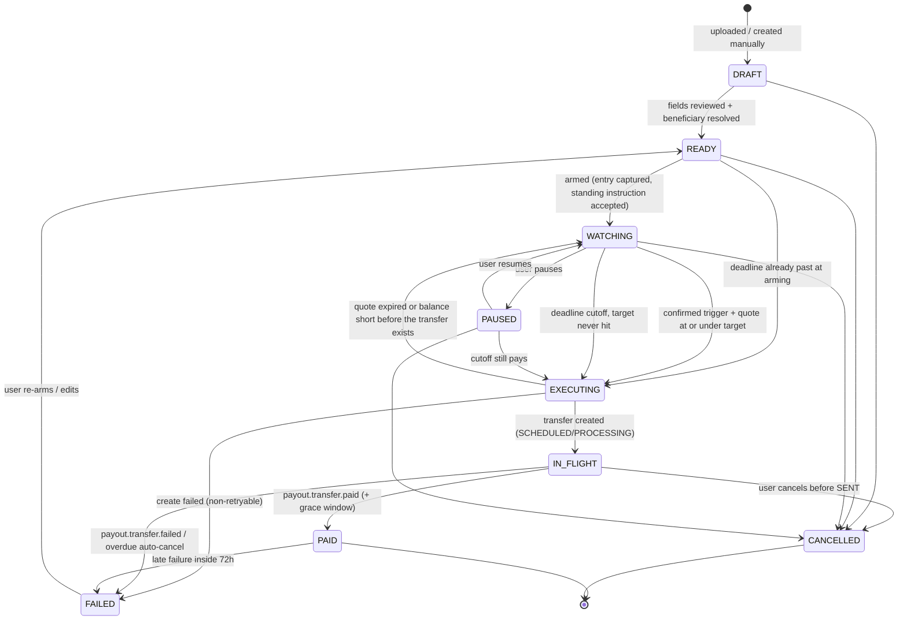
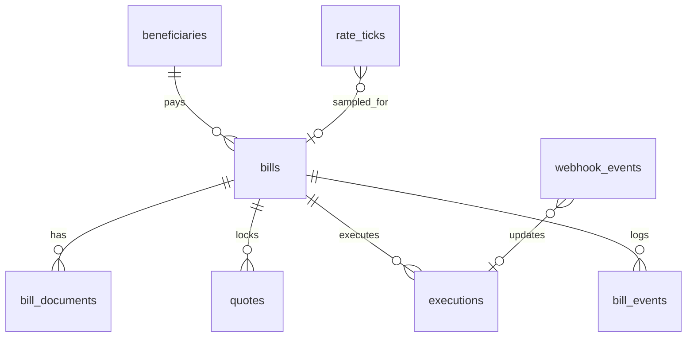

# 03 — Domain Model

## 1. Bill lifecycle (state machine)



### State reference

| State | Meaning | UI badge | Who/what moves it on |
| --- | --- | --- | --- |
| `DRAFT` | Extracted or entered, not yet reviewed | `Draft` (muted) | User review |
| `READY` | Valid bill + beneficiary, strategy not yet armed. A bill with anything still missing stays `DRAFT` | `Ready` (neutral) | User arms |
| `WATCHING` | Armed; the worker is comparing the live rate to this bill's target | `Watching` (orange pulse) | Worker trigger, cutoff, user |
| `PAUSED` | Monitoring suspended; **deadline still enforced** | `Paused` (muted) | User, cutoff |
| `EXECUTING` | Quote locked and the transfer is being created | `Executing` (spinner) | Executor |
| `IN_FLIGHT` | Transfer exists at Airwallex, not yet paid | `In flight · SENT` etc. | Webhooks / reconciler |
| `PAID` | Beneficiary paid | `Paid` (green) | Terminal |
| `FAILED` | Execution or payout failed | `Failed` (red) | User |
| `CANCELLED` | User cancelled | `Cancelled` | Terminal |

### Invariants

1. **At most one active execution per bill.** Enforced by a partial unique index on `executions { billId: 1 }` with `partialFilterExpression: { active: true }`, by a deterministic `request_id`, and by the BullMQ `jobId` `execute.{billId}.{attempt}`.
2. **All transitions go through `transition(bill, event)`** in `server/domain/stateMachine.ts`. The service applies it as one atomic conditional `findOneAndUpdate` on the bill (`state ∈ allowedFrom` and `version = expected`, then `$inc: { version: 1 }`), then inserts a `bill_events` document. A `null` result means another process won the race. See [02 §9.3](./02-architecture.md#93-consistency-without-row-locks).
3. **The deadline overrides every non-terminal state.** A `WATCHING` or `PAUSED` bill whose cutoff has passed moves to `EXECUTING` and pays at market.
4. **A payment uses a quote locked in the same job.** If the locked quote is worse than the target, or it expires before the transfer is created, the bill stays `WATCHING`. A multi-document transaction is used only when creating the execution.

---

## 2. Rate math

### 2.1 Canonical price

For a bill of amount **A** in currency **F**, paid from home currency **H**:

- Request `GET /fx/rates/current?buy_currency=F&sell_currency=H&buy_amount=A`.
- Take the `rate_details` entry with `level = CLIENT`.
- **Canonical price** `p = sell_amount / buy_amount` = units of H per 1 F (all-in client price, before transfer fees).

We **do not** use the `rate` or `client_rate` fields directly, because their orientation follows `currency_pair`. Deriving the price from amounts is orientation-proof. We store both the raw response and `p`.

The display pair is `F/H` (e.g. `EUR/USD`), so a **lower price means a cheaper bill**. When `p < 0.01` (e.g. JPY/USD), the UI offers an **inverted display** (`USD/JPY`, where higher is better). This is display-only; all logic uses `p`.

### 2.2 Cost, savings, distance

| Quantity | Formula | Precision |
| --- | --- | --- |
| Estimated cost (H) | `A × p + fee_est_H` | round to H precision |
| Entry cost | `A × p_entry + fee_est_H` | |
| Savings vs entry (PnL) | `A × (p_entry − p_now)` | H precision; sign = favorable |
| Savings % | `(p_entry − p_now) / p_entry` | 2 dp |
| Distance to target | `(p_now − p_target) / p_now` | bps and %; ≤ 0 means at/through target |
| Target cost | `A × p_target + fee_est_H` | |

`fee_est_H` starts at 0 and is refined from `transfers/validate`, or from the `fee_amount` of the first transfer for the same corridor (cached per `(F, H, method)`).

### 2.3 Strategy modes

| Mode | User enters | Stored | Equivalent shown |
| --- | --- | --- | --- |
| `TARGET_RATE` | `p_target` | `p_target` | Max cost = `A × p_target + fee_est_H` |
| `MAX_COST` | `M` (in H) | `M`, derived `p_target = (M − fee_est_H) / A` | Target rate |

- `p_target` is recomputed when `fee_est_H` changes in `MAX_COST` mode, and the UI shows a "target adjusted for fees" note.
- Validation: `p_target < p_entry` gets a warning only; `p_target ≥ p_entry` shows "Target already met — pay now?". The target must be > 0.

### 2.4 Money rules

- Use `decimal.js` everywhere. JS numbers are never used for money or rates.
- Round amounts to the currency precision table (`src/contracts/currencies.ts`, generated from the Airwallex currency precision page). Airwallex payout precision differs from ISO for **KES and SAR (0 dp)**; see [13 §1.1](./13-airwallex-contracts.md#11-currency-precision).
- Prices are stored with 10 significant digits and displayed with pair-dependent decimals (default 5; 3 for JPY-quoted pairs).

---

## 3. Trigger rules

Evaluated by the strategy engine on every tick for `WATCHING` bills:

1. **Threshold:** `p_now ≤ p_target × (1 − buffer_bps/10_000)` (default buffer 0).
2. **Confirmation:** the threshold holds for `TRIGGER_CONFIRM_TICKS` consecutive ticks (default 2). This avoids reacting to single-tick noise.
3. **Freshness:** the tick must be younger than `2 × POLL_INTERVAL_MS`. Stale feeds never trigger.
4. **Cooldown:** after a near miss, do not re-trigger for `REARM_COOLDOWN` (default 10 min, or 2 min in demo), unless the price improves by ≥ `REARM_IMPROVE_BPS` (default 10 bps).
5. **Quote check:** lock a quote with the shortest validity Airwallex offers, long enough for this job to create the transfer. Define `p_quote = sell_amount / buy_amount` from the quote.
   - `p_quote ≤ p_target` → `EXECUTING` in the same job. The activity log records `QUOTE_LOCKED`; the chart marks it `TARGET_HIT`.
   - Otherwise → `NEAR_MISS` event (shown on the chart as a hollow marker) and stay `WATCHING`.
   - If the wallet balance in H is short, stay `WATCHING`, raise `insufficientBalance`, and retry until the cutoff.
   - **Demo exception:** when the triggering tick is simulated (`source = 'SIMULATED'`: a Simulate run or `RATE_SOURCE=simulated`), a real sandbox quote can't be expected to follow it. The check then compares the simulated price with the target instead of `p_quote`, and records both on the `QUOTE_LOCKED` event. The transfer still executes at the real quote. See [08 §1.1](./08-demo-plan.md#11-simulate-button).
   - If `valid_to_at` has already passed, stay `WATCHING`, record `QUOTE_EXPIRED`, and enqueue `quote-retry.{billId}`.

A ready tick enqueues `trigger.{billId}.{tickId}`. That job locks `quoteValidityTarget`. Pay now (`POST /api/bills/:id/pay-now`, `WATCHING` only) locks `MIN_1` and enqueues execution with mode `MANUAL`. A strategy edit while `WATCHING` recomputes the target, re-evaluates immediately, and logs `STRATEGY_UPDATED`.

### Deadline rules

- `execution_deadline = subtractBusinessDays(due_date, lead_days(method), skip)` in `AIRWALLEX_ACCOUNT_TZ`. Weekends and the pair's **non-conversion days** (`GET /reference/invalid_conversion_dates`, [13 §6](./13-airwallex-contracts.md#6-balances-and-reference-data)) are skipped. Payout-rail holidays are still not modelled; the lead days absorb them.
  - Default `lead_days`: the chosen transfer method's `flight_time.max` from the beneficiary form schema + 1 business day ([13 §5.3](./13-airwallex-contracts.md#53-method-lead-days-and-limits)), falling back to `LOCAL = 1`, `SWIFT = 3`. Configurable per bill.
  - If `execution_deadline` is already in the past when arming, the bill goes straight to `EXECUTING` (UI: "Due now") and pays at market.
- At arming, write one timer onto the bill document: `timers.autosettleAt` (a UTC instant computed in the account time zone) = `execution_deadline @ DEADLINE_AUTOSETTLE_CUTOFF` (14:00). If the bill is still `WATCHING` or `PAUSED`, lock a short quote and move it to `EXECUTING`. The activity log records `AUTOSETTLE`. The ticket's deadline meter already says the bill pays at market that day if the target is not hit.
- The worker **sweeper** runs every second. It queries `{ 'timers.autosettleAt': { $lte: clock.now() }, 'timers.autosettleFiredAt': null, state: { $in: ['WATCHING', 'PAUSED'] } }`, then adds a BullMQ job with the deterministic ID `deadline.autosettle.{billId}`. The job locks a `MIN_1` quote, records `AUTOSETTLE`, moves the bill to `EXECUTING`, and enqueues execution with mode `DEADLINE`. It sets `autosettleFiredAt` only after that succeeds. If the quote cannot be locked, the bill stays `WATCHING` or `PAUSED` and the sweeper retries. A due-date or lead-day edit recomputes `autosettleAt`, and clears `autosettleFiredAt` when the new cutoff is still in the future.
- With `DEADLINE_SAFETY_NET=airwallex`, arming also creates a future-dated transfer (`transfer_date` = the execution deadline, `lock_rate_on_create=false`, `request_id` = `sn:{billId}`). Its id is `safetyNetTransferId` on the bill. Target hit, pay now, and the cutoff cancel it before they execute. The default `none` does not call Airwallex.
- Jobs are idempotent and state-guarded. Because timers are data, restarts need no special handling: any timer that became due while the worker was down is picked up by the first sweep.

---

## 4. Data model (MongoDB / Mongoose)

Conventions:
- Models live in `src/server/db/models/*.ts`. Fields are camelCase, collection names are snake_case plurals, and every schema has `timestamps: true`.
- Money and rate fields are `Decimal128` (shown as **D128** below), converted to `decimal.js` at the repository boundary. See [02 §9.4](./02-architecture.md#94-money-in-mongodb).
- Things that are 1:1 with a bill and always read with it (strategy, timers, entry) are **embedded**. Things with their own lifecycle or unbounded growth (executions, events, ticks) are **separate collections** that reference `billId`.
- Indexes are declared on the schemas and synced by `pnpm db:indexes` (`Model.syncIndexes()`), so there is no `autoIndex` in production. Data migrations, if any, use `migrate-mongo` in `scripts/migrations`.



### Collections

**`bills`**
```ts
{
  _id: ObjectId,
  state: BillState,                       // §1
  version: number,                        // optimistic concurrency
  vendorName: string,
  invoiceNumber: string,
  billCurrency: string,                   // F
  billAmount: D128,                       // A
  homeCurrency: string,                   // H
  issuedDate?: Date,
  dueDate: Date,                          // date-only, stored at 00:00 UTC
  executionDeadline: Date,                // derived
  transferMethod: 'LOCAL' | 'SWIFT',
  leadDays: number,
  beneficiaryId?: ObjectId,               // → beneficiaries
  reference?: string,                     // payment reference shown to the vendor (Airwallex `reference`, required)
  transferReason: string,                 // Airwallex `reason` enum, default 'bill_payment'
  entry?: { price: D128, at: Date },      // set at arming
  standingInstruction?: { at: Date, by: ObjectId },  // required to arm
  strategy?: {
    mode: 'TARGET_RATE' | 'MAX_COST',
    targetPrice: D128,
    maxCost?: D128,
    feeEstimate: D128,
    bufferBps: number,
    confirmTicks: number,
    quoteValidityTarget: QuoteValidity,
    quoteValidityDeadline: QuoteValidity,
    autosettleCutoff: string,             // 'HH:mm' account tz
  },
  timers: {                               // read by the sweeper
    autosettleAt?: Date, autosettleFiredAt?: Date,
    cooldownUntil?: Date,
  },
  trigger: { consecutiveHits: number, lastEvaluatedTickAt?: Date },
  last?: { price: D128, at: Date, source: RateSourceKind },  // denormalised mark price for list views
  activeExecutionId?: ObjectId,
  recentEvents: BillEventLite[],          // capped at 20 via $slice, for fast ticket rendering
  displayInverted: boolean,
  colorTag?: string,
  seedKey?: string,                       // seed idempotency (unique, sparse): 'demo:…' or 'gen:v1:{seed}:{i}'
  generated?: boolean,                    // created by the test-data generator (see 11)
  createdAt: Date, updatedAt: Date,
}
```
Indexes: `{ state: 1, 'timers.autosettleAt': 1 }`, `{ state: 1, billCurrency: 1, homeCurrency: 1 }`, and non-unique `{ vendorName: 1, invoiceNumber: 1 }` used by the duplicate-invoice check. A duplicate is a review **warning**, not a hard block, so this index is deliberately not unique.

**`bill_documents`**: `{ billId, filename, mime, size, sha256, storageKey, airwallexFileId?, extraction: { status: 'PENDING'|'RUNNING'|'DONE'|'FAILED', result?: ExtractedBill, error? }, createdAt }`. `ExtractedBill` (per-field value, confidence, source, reasons, evidence, boxes) is defined in [12 §3](./12-bill-extraction.md#3-contract). Indexes `{ billId: 1 }` and `{ sha256: 1 }` (extraction cache: the same file is never sent to the model twice).

**`beneficiaries`** (a cache of the Airwallex beneficiary, plus display fields): `{ airwallexBeneficiaryId (unique), name, entityType, bankCountry, accountCurrency, bankName?, maskedAccount, transferMethods: string[], verification?: { code, nameMatch?, resolvedAccountName?, checkedAt }, raw: Mixed }` (bank fields in `raw` are redacted; see [13 §5](./13-airwallex-contracts.md#5-beneficiaries)).

**`rate_ticks`**: a **time-series collection** (`timeseries: { timeField: 'ts', metaField: 'meta', granularity: 'seconds' }`, `expireAfterSeconds` from `RATE_TICKS_TTL_DAYS`, default 30 days; 7 on Atlas M0).
```ts
{ ts: Date, meta: { base: string, quote: string, billId?: ObjectId, source: 'AIRWALLEX'|'SIMULATED'|'REFERENCE', simId?: string }, price: D128, raw?: Mixed }
```
Secondary index `{ 'meta.base': 1, 'meta.quote': 1, ts: 1 }`. Chart candles come from an aggregation with `$dateTrunc` (1m, 5m, 1h). A tick with `simId` is one Simulate session for `meta.billId`: the pair aggregation, the pair mark, and the arm snapshot skip it. That bill's chart appends those ticks at their own timestamps and returns them as `simulatedRanges`. A repeatable job writes 1-minute rollups into **`rate_candles_1m`** (`{ base, quote, t, o, h, l, c }`, unique `{ base, quote, t }`) for fast long-range charts, kept indefinitely.

**`reference_rates`**: third-party daily history cache `{ base, quote, date, mid: D128, source: 'FRANKFURTER' }`, unique `{ base, quote, date, source }`.

**`quotes`**: `{ billId, airwallexQuoteId (unique), purpose: 'TARGET'|'DEADLINE'|'AUTOSETTLE'|'MANUAL', validity, usage, currencyPair, conversionDate, price: D128, clientRate: D128, awxRate?: D128, midRate?: D128, buyAmount: D128, sellAmount: D128, validFromAt, validToAt, raw: Mixed }`. `clientRate`/`midRate` are stored as Airwallex sends them (market convention of `currencyPair`); `price` is the canonical `p`.

**`executions`**: `{ billId, mode: 'TARGET'|'DEADLINE'|'MANUAL', attempt, requestId (unique), active: boolean, airwallexTransferId?, shortReferenceId?, transferStatus?, fundingStatus?, statusUpdatedAt?, awxUpdatedAt?, conversionRate?: D128, sourceAmount?: D128, amountPayerPays?: D128, amountBeneficiaryReceives?: D128, feeAmount?: D128, feeCurrency?, feePaidBy?, swiftChargeOption?, dispatchDate?, lateFailureWatchUntil?, failure?: { code?, message?, reasonCodes?, category }, raw: Mixed }`. `mode` is why the payment started: the target was hit (`TARGET`), the cutoff paid at market (`DEADLINE`), or the user chose pay now (`MANUAL`). `awxUpdatedAt` is Airwallex's `updated_at` and is used for the ordering guard. Field mapping: [13 §4.2](./13-airwallex-contracts.md#42-response--executions--executionsummary--transfertracker). Indexes: partial unique `{ billId: 1 }` where `{ active: true }` (invariant 1), unique sparse `{ airwallexTransferId: 1 }`.

**`bill_events`** (append-only audit log that drives the Activity feed): `{ billId, ts, type, actor: 'user:<id>'|'system'|'airwallex', payload: Mixed }`. Types: `ARMED`, `TICK_CROSSED`, `QUOTE_LOCKED`, `NEAR_MISS`, `QUOTE_EXPIRED`, `AUTOSETTLE`, `CANCELLED`, `TRANSFER_CREATED`, `TRANSFER_STATUS`, `PAID`, `FAILED`, `STRATEGY_UPDATED`, `PAUSED`, `RESUMED`, `REARMED`, `CATCH_UP`, `SIM_STARTED`, `SIM_ENDED` (demo only). A target hit is `QUOTE_LOCKED`. A deadline payment is `AUTOSETTLE`. A Simulate run records `QUOTE_LOCKED` with actor `system:demo-sim` and payload `{ simId, price }`. Index `{ billId: 1, ts: -1 }`.

**`webhook_events`**: `{ _id: <Airwallex event id>, name, createdAt, receivedAt, payload: Mixed, processedAt?, error? }`. An insert that fails with duplicate-key error `11000` identifies a duplicate delivery.

**`users`** (demo): `{ name, email (unique) }`.

**`settings`** (single document, `_id: 'global'`): home currency, default lead days, quote validity, the 14:00 cutoff.

---

## 5. Contracts (shared FE/BE)

These live in `src/contracts`. They are defined **before** the UI kit is built, so fixtures and components share one shape. `ExtractedBill` is `src/contracts/extraction.ts` ([12 §3](./12-bill-extraction.md#3-contract)). Extraction progress is the `extraction.progress` SSE event ([02 §6](./02-architecture.md#6-realtime-events-sse)). Every type that carries Airwallex data (quotes, transfers, fees, beneficiaries, balances, currencies, errors) is specified field by field in [13 Airwallex → Contracts & UI](./13-airwallex-contracts.md), including enums, status maps and error codes.

```ts
type Ccy = string; // ISO 4217, validated against currencies table
type BillState = 'DRAFT'|'READY'|'WATCHING'|'PAUSED'|'EXECUTING'|'IN_FLIGHT'|'PAID'|'FAILED'|'CANCELLED';

interface BillSummary {
  id: string;
  state: BillState;
  vendorName: string;
  invoiceNumber: string;
  pair: { base: Ccy; quote: Ccy };        // base = F, quote = H
  amount: string;                          // decimal string, F
  dueDate: string;                         // ISO date
  executionDeadline: string;
  entryPrice?: string;
  targetPrice?: string;
  maxCost?: string;
  strategyMode?: 'TARGET_RATE'|'MAX_COST';
  lastPrice?: string;
  lastTickAt?: string;
  savings?: string;                        // H, signed
  savingsPct?: string;
  distanceToTargetBps?: number;
  estCost?: string;                        // H
  transferMethod: 'LOCAL'|'SWIFT';
  transferReason: TransferReason;          // Airwallex `reason` enum, default 'bill_payment' (13 §4.1)
  reference: string;                       // shown to the vendor; defaults to the invoice number
  beneficiary?: BeneficiarySummary;        // incl. account verification (13 §5.4)
  execution?: ExecutionSummary;
  safetyNetTransferId?: string;            // Layer B scheduled transfer, only when the flag is on
  flags: { stale?: boolean; insufficientBalance?: boolean; noReferenceHistory?: boolean;
           overdue?: boolean; awxApproval?: boolean; amountLimit?: boolean; routeUnsupported?: boolean; nameMismatch?: boolean };
  allowedActions: BillAction[];            // from the bill state; see below
}

type BillAction =
  | 'REVIEW' | 'EDIT' | 'RESOLVE_BENEFICIARY' | 'ARM' | 'EDIT_STRATEGY'
  | 'PAUSE' | 'RESUME' | 'PAY_NOW' | 'CANCEL' | 'REARM'
  | 'ADVANCE_TRANSFER' | 'SIMULATE' | 'STOP_SIMULATION';   // demo only (DEMO_MODE + sandbox); see 08 §1.1

// ExecutionSummary, QuoteSummary, BalanceSummary, CurrencyInfo, BeneficiarySummary,
// BeneficiaryFormSchema, FieldError and ApiError are field-mapped from Airwallex in 13 §8.

interface ChartSeriesPoint { time: number; value: string }       // unix seconds
interface ChartOverlays {
  entry?: string; target?: string; quote?: { price: string; from: number; to: number };
  executionDeadline: number; dueDate: number; now: number;
  markers: Array<{ time: number; kind: 'ARMED'|'NEAR_MISS'|'TARGET_HIT'|'EXECUTED'|'AUTOSETTLE'|'SIM_START'|'SIM_END'; label?: string }>;
  simulatedRanges?: Array<{ from: number; to?: number }>;   // demo: segments drawn in the simulated style
}
```

**`allowedActions`** is computed by a pure `allowedActions(bill)` in `src/contracts/permissions.ts`, from the bill state (§1). The server uses it to fill the DTO and to reject a request early with `INVALID_STATE` before calling `transition()`. The mock `DataSource` uses the same function. The UI renders ticket and row actions only from this list and never re-derives state rules.

`HealthReport` (`src/contracts/health.ts`) is the body of `GET /api/health`. `ok` is true only when `checks.mongo`, `checks.redis`, `checks.worker`, and `checks.airwallex` are all `ok`. `feeds` is one row per active pair (`ageMs`, `fresh` when the newest tick is younger than two poll intervals). `queues` lists waiting, active, delayed, and failed counts. A mock payments gateway reports the Airwallex check as `ok` without a login.

## 6. Internal REST API

| Method | Path | Purpose |
| --- | --- | --- |
| `POST` | `/api/uploads` | Multipart, many files → creates `DRAFT` bills + starts extraction. Returns `429` `RATE_LIMITED` when the uncached files would exceed the Anthropic window, and writes nothing |
| `GET` | `/api/bills` | List `BillSummary[]` (filters: state, pair) |
| `GET` | `/api/bills/:id` | Bill detail (summary + documents + strategy + beneficiary) |
| `PATCH` | `/api/bills/:id` | Edit reviewed fields (DRAFT/READY/FAILED only). `billCurrency` is accepted on a draft only, and clears the stored mark so the next review reads the shared pair price |
| `POST` | `/api/bills/:id/beneficiary` | Resolve/create the Airwallex beneficiary |
| `PUT` | `/api/bills/:id/strategy` | Set or update the strategy (`READY`, `WATCHING`, or `PAUSED`). A watching bill re-evaluates the trigger. It does not arm |
| `POST` | `/api/bills/:id/review` | Mark a draft reviewed. Requires a beneficiary, an amount above zero, and a bill currency other than the home currency. If the bill has no mark yet, `last` is set from the shared pair price (never a Simulate session). Moves it to `READY` |
| `POST` | `/api/bills/:id/arm` | Capture entry, consent, schedule deadline jobs |
| `POST` | `/api/bills/:id/pause` / `resume` / `rearm` | Pause, resume, or return a failed bill to ready |
| `POST` | `/api/bills/:id/pay-now` | Lock a quote and pay at market immediately (`mode: MANUAL`) |
| `POST` | `/api/bills/:id/cancel` | |
| `GET` | `/api/bills/:id/chart?range=1D` | Merged series (ECB daily history plus shared ticks) + `ChartOverlays` + the reference series. Simulate ticks (`simId`) are appended only for the bill that owns them, with `simulatedRanges`. `TO_DUE` looks back 90 days. `flags.stale` is set when a watching or paused bill's last tick is older than two poll intervals. `flags.noReferenceHistory` is set when `HISTORY_SOURCE=none` |
| `GET` | `/api/bills/:id/events` | Activity log |
| `GET` | `/api/balances` | Proxy of Airwallex balances (cached 30 s) |
| `POST` | `/api/bills/:id/validate-transfer` | `transfers/validate` dry run (also run by `arm`); returns `FieldError[]` |
| `POST` | `/api/beneficiaries/schema` | Beneficiary form schema for a corridor (cached 24 h) |
| `GET` | `/api/beneficiaries/banks` | Bank search for `DYNAMIC_SELECT` fields |
| `POST` | `/api/beneficiaries/validate` · `/api/beneficiaries/verify` | Validate before create · account/name verification |
| `GET` | `/api/reference/currencies` · `/api/reference/non-conversion-days?pair=` | Currency capability + precision · FX holidays |
| `GET` | `/api/health` | `HealthReport`. `200` when Mongo, Redis, the worker heartbeat, and the Airwallex token are ok; `503` otherwise. The body still lists feed freshness and queue depths |
| `GET` | `/api/stream` | SSE |
| `POST` | `/api/webhooks/airwallex` | Airwallex webhooks |
| `POST` | `/api/demo/*` | Demo controls (see [08](./08-demo-plan.md)) |

Error envelope: `{ error: ApiError }` with `{ code, message, fieldErrors?, details?, airwallex?: { code, source? } }`. Codes: `INVALID_STATE`, `FORBIDDEN`, `NOT_FOUND`, `VALIDATION_FAILED`, `QUOTE_EXPIRED`, `QUOTE_INVALID`, `INSUFFICIENT_BALANCE`, `AMOUNT_LIMIT`, `ROUTE_UNSUPPORTED`, `DATE_INVALID`, `CORRIDOR_REQUIREMENT`, `TRANSFER_NOT_CANCELLABLE`, `RATE_LIMITED`, `AIRWALLEX_UNAVAILABLE`, `AIRWALLEX_CONFIG`, `AIRWALLEX_ERROR`. The mapping from Airwallex codes is in [13 §2.1](./13-airwallex-contracts.md#21-error-codes--our-codes--ui).
