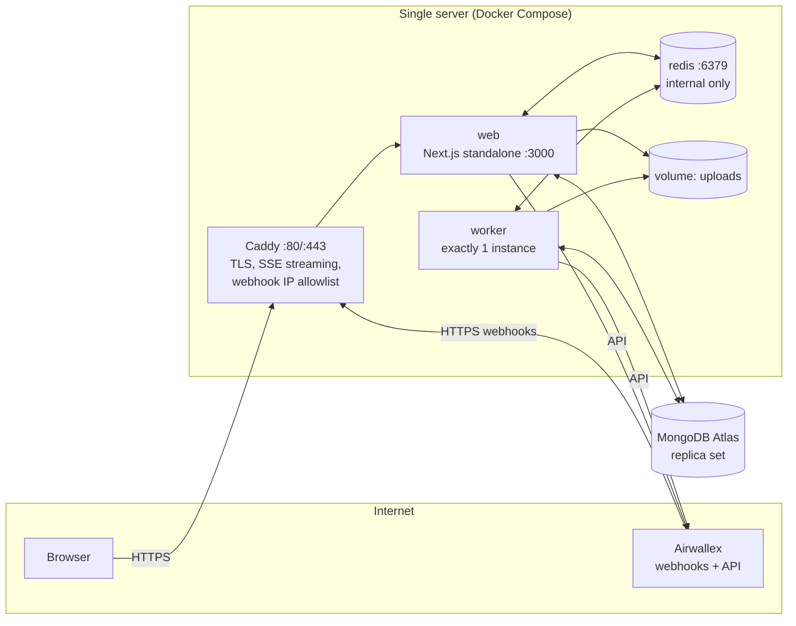

# 10 — Deployment

**Target:** a single Linux server running the **Next.js app**, the **worker** and **Redis** in Docker Compose, behind **Caddy** (reverse proxy + automatic HTTPS). **MongoDB** runs on **MongoDB Atlas** by default; a same-server option is described in §5.2.

This is appropriate for a demo. It keeps operations simple, and the design already tolerates restarts: timers live in MongoDB, jobs persist in Redis, and payment calls are idempotent.

---

## 1. Topology



| Port | Exposed publicly | Service |
| --- | --- | --- |
| 22 | Yes (restrict to team IPs if possible) | SSH |
| 80, 443 | Yes | Caddy |
| 3000 | **No** (Docker network only) | web |
| 6379 | **No** (Docker network only) | redis |

---

## 2. Server

| Item | Recommendation |
| --- | --- |
| Size | 2 vCPU, 4 GB RAM, 40 GB SSD (enough for the demo with headroom) |
| OS | Ubuntu 24.04 LTS |
| IP | Static public IP (needed for the Atlas IP access list) |
| DNS | `A` record, e.g. `fx-demo.<domain>` → server IP (Caddy needs it for certificates) |
| Clock | System time zone **UTC** and NTP enabled (`timedatectl set-timezone UTC`). All deadline logic uses `AIRWALLEX_ACCOUNT_TZ`, never the server time zone. |
| Firewall | `ufw default deny incoming`, then `ufw allow 22,80,443/tcp` |
| Docker | Docker Engine + Compose plugin; a non-root deploy user in the `docker` group |
| Swap | 2 GB swap file (protects against Next.js build and memory spikes) |

---

## 3. Build: one Dockerfile, two targets

The web app and the worker share the codebase but ship as separate images:

- **`web`** uses Next.js `output: 'standalone'`, so the image is small and only contains traced files.
- **`worker`** is bundled with `tsup` into `dist/worker/index.js` and installed with production `node_modules`.

```dockerfile
# Dockerfile
FROM node:22-alpine AS base
RUN corepack enable
WORKDIR /app

FROM base AS deps
COPY package.json pnpm-lock.yaml ./
RUN pnpm install --frozen-lockfile

FROM deps AS build
COPY . .
ENV NEXT_TELEMETRY_DISABLED=1
RUN pnpm build            # next build (standalone) + tsup worker + scripts

FROM base AS prod-deps
COPY package.json pnpm-lock.yaml ./
RUN pnpm install --frozen-lockfile --prod

# ---- web ----
FROM node:22-alpine AS web
WORKDIR /app
ENV NODE_ENV=production TZ=UTC PORT=3000 HOSTNAME=0.0.0.0
COPY --from=build /app/.next/standalone ./
COPY --from=build /app/.next/static ./.next/static
COPY --from=build /app/public ./public
USER node
EXPOSE 3000
CMD ["node", "server.js"]

# ---- worker ----
FROM node:22-alpine AS worker
WORKDIR /app
ENV NODE_ENV=production TZ=UTC
COPY --from=prod-deps /app/node_modules ./node_modules
COPY --from=build /app/dist ./dist
USER node
CMD ["node", "dist/worker/index.js"]
```

`package.json` scripts (sketch):

```json
{
  "build": "next build && tsup src/worker/index.ts scripts/*.ts --out-dir dist --format esm --target node22",
  "start:web": "node .next/standalone/server.js",
  "start:worker": "node dist/worker/index.js",
  "db:indexes": "node dist/scripts/db-indexes.js"
}
```

Images are built in CI (GitHub Actions) and pushed to GHCR as `ghcr.io/<org>/fx-target-web:<git-sha>` and `ghcr.io/<org>/fx-target-worker:<git-sha>`. Building on the server also works, but it needs the swap file and takes CPU away from the running app.

---

## 4. Compose (production)

```yaml
# /opt/fx-target/docker-compose.yml
name: fx-target

x-logging: &logging
  driver: json-file
  options: { max-size: "10m", max-file: "5" }

x-app-env: &app-env
  env_file: .env.production
  environment:
    REDIS_URL: redis://:${REDIS_PASSWORD}@redis:6379
    UPLOADS_DIR: /data/uploads
    TZ: UTC

services:
  caddy:
    image: caddy:2
    restart: unless-stopped
    ports: ["80:80", "443:443"]
    volumes:
      - ./Caddyfile:/etc/caddy/Caddyfile:ro
      - caddy_data:/data
      - caddy_config:/config
    depends_on: [web]
    logging: *logging

  web:
    image: ghcr.io/<org>/fx-target-web:${IMAGE_TAG}
    restart: unless-stopped
    <<: *app-env
    volumes: [uploads:/data/uploads]
    depends_on:
      redis: { condition: service_healthy }
    healthcheck:
      test: ["CMD", "wget", "-qO-", "http://localhost:3000/api/health"]
      interval: 15s
      timeout: 5s
      retries: 5
    stop_grace_period: 20s
    logging: *logging

  worker:
    image: ghcr.io/<org>/fx-target-worker:${IMAGE_TAG}
    restart: unless-stopped
    <<: *app-env
    volumes: [uploads:/data/uploads]
    depends_on:
      redis: { condition: service_healthy }
    stop_grace_period: 60s        # lets in-flight jobs finish on deploy
    logging: *logging
    # Never scale this service. The poller and sweeper must run exactly once (see §6).

  redis:
    image: redis:7
    restart: unless-stopped
    command: ["redis-server", "/usr/local/etc/redis/redis.conf", "--requirepass", "${REDIS_PASSWORD}"]
    volumes:
      - ./redis.conf:/usr/local/etc/redis/redis.conf:ro
      - redis_data:/data
    healthcheck:
      test: ["CMD-SHELL", "redis-cli -a \"$$REDIS_PASSWORD\" ping | grep PONG"]
      interval: 10s
      retries: 5
    environment:
      REDIS_PASSWORD: ${REDIS_PASSWORD}
    logging: *logging
    # No `ports:`. Redis is reachable only on the Compose network.

volumes:
  caddy_data:
  caddy_config:
  redis_data:
  uploads:
```

`/opt/fx-target/.env` (read by Compose for interpolation): `IMAGE_TAG=<git-sha>` and `REDIS_PASSWORD=<random 32+ chars>`.

---

## 5. Data stores

### 5.1 Redis

```conf
# /opt/fx-target/redis.conf
bind 0.0.0.0                  # inside the container; the port is not published on the host
protected-mode yes
appendonly yes                # BullMQ jobs must survive restarts
appendfsync everysec
maxmemory 512mb
maxmemory-policy noeviction   # REQUIRED by BullMQ; evicting keys corrupts queues
save 900 1                    # RDB snapshot as a second safety net
```

Client settings in `src/server/queue`:
- BullMQ `Worker` connections use `maxRetriesPerRequest: null` (BullMQ requires this for blocking commands).
- Use a separate connection for pub/sub subscribers, because a subscribed connection can't run other commands.
- Retain completed jobs `{ age: 86400, count: 1000 }` and failed jobs `{ age: 604800 }` so memory stays bounded.

### 5.2 MongoDB

**Option A: Atlas (default).**
- Cluster: **M0 (free)**, for development and the live demo (Q-08). It is a replica set, so transactions work, but it has shared resources, a small storage cap and throughput limits (check Atlas's current M0 limits). Keep within them:
  - Set `RATE_TICKS_TTL_DAYS=7` (default 30) so `rate_ticks` stays small; the 1-minute candles keep long-range charts.
  - Run the `stress` seed profile (200 bills) against local Mongo (`pnpm infra:up`), not Atlas.
  - In B0, confirm on the actual cluster that time-series collections and `syncIndexes` work (`pnpm db:indexes`).
  - If the demo feels slow or throttled, move up to M10 or use Option B; nothing in the code changes.
- Region: the same region as the server (keeps latency under 5 ms).
- Network access: add the server's static IP only.
- Database user: least privilege (`readWrite` on `fxtarget`).
- `MONGODB_URI=mongodb+srv://<user>:<pass>@<cluster>/fxtarget?retryWrites=true&w=majority`
- Backups: Atlas continuous backup on M10+; on M0, run the `mongodump` cron below.

**Option B: same server.** Add a `mongo` service to Compose:
- `mongo:7` with `--replSet rs0 --keyFile /etc/mongo/keyfile --auth`. A keyfile is mandatory when auth is enabled on a replica set.
- Do not publish port 27017. Initialise with `rs.initiate({ _id: 'rs0', members: [{ _id: 0, host: 'mongo:27017' }] })`.
- Store data on a dedicated volume and budget 1 GB of RAM for it (so move to 8 GB RAM if Mongo shares the box).
- Nightly `mongodump --archive --gzip` via cron to off-box storage (S3/R2/B2), keeping 7 days.

### 5.3 Uploads

Bill documents live on the `uploads` volume, mounted into both `web` and `worker`. Back it up nightly together with the Mongo dump (`tar` the volume to the same bucket). Sandbox-only data can skip backups if the team agrees.

---

## 6. Singleton worker

The **poller** and the **sweeper** must run exactly once. BullMQ job processing is safe to run in parallel, but a duplicate poller doubles the Airwallex rate-limit usage, and a duplicate sweeper races on timers. (The deterministic `jobId`s still prevent double execution.)

Two layers of protection:
1. **Compose:** there is a single `worker` service and it is never scaled (documented in the file).
2. **Redis leader lock** in the worker: on boot, `SET worker:leader <instanceId> NX PX 15000`, renewed every 5 s. Only the lock holder starts the poller and sweeper. If the lock is lost, it stops them. BullMQ processors run regardless.

On deploy, Compose stops the old worker (it waits up to `stop_grace_period`) before starting the new one. The lock expires within 15 s even if a process dies without releasing it.

**Graceful shutdown (SIGTERM):**
1. Stop the poller and sweeper, and release the leader lock.
2. `await worker.close()` on every BullMQ worker, which waits for active jobs to finish.
3. Close the Redis and Mongo connections, then exit 0.

If a job is killed mid-flight anyway, BullMQ marks it stalled and retries it. Execution retries reuse the same Airwallex `request_id`, so a payment can never be created twice.

---

## 7. Reverse proxy (Caddy)

```caddyfile
# /opt/fx-target/Caddyfile
fx-demo.example.com {
  encode zstd gzip

  # Live stream: no buffering, no compression, long-lived
  @sse path /api/stream
  handle @sse {
    reverse_proxy web:3000 {
      flush_interval -1
      transport http {
        read_timeout 0
      }
    }
  }

  # Airwallex webhooks: only accept Airwallex IPs
  @webhook path /api/webhooks/airwallex
  handle @webhook {
    @notAirwallex not remote_ip 35.240.211.132 35.187.239.216 34.87.139.23 136.110.35.143 34.142.189.194 35.197.128.86
    respond @notAirwallex 403
    request_body { max_size 1MB }
    reverse_proxy web:3000
  }

  # Optional: protect the whole demo host during rehearsals
  # basic_auth { demo <bcrypt-hash> }

  handle {
    request_body { max_size 25MB }   # bill uploads (≤ 20 MB per file + multipart overhead)
    reverse_proxy web:3000
  }

  header {
    Strict-Transport-Security "max-age=31536000"
    X-Content-Type-Options nosniff
    Referrer-Policy strict-origin-when-cross-origin
    -Server
  }
}
```

The allowlist above is the **sandbox** webhook IP list from Airwallex's ["Listen for webhook events"](https://www.airwallex.com/docs/developer-tools/webhooks/listen-for-webhook-events#whitelist-ip-addresses) page. For production, replace it with the production list from the same page and re-check it before each go-live.

**App-side requirements for SSE** (`src/app/api/stream/route.ts`):
- `export const runtime = 'nodejs'` and `export const dynamic = 'force-dynamic'`
- Response headers: `Content-Type: text/event-stream`, `Cache-Control: no-cache, no-transform`, `Connection: keep-alive`, `X-Accel-Buffering: no` (the last one helps if nginx is used instead of Caddy)
- Heartbeat comment (`: ping`) every 15 s so idle connections aren't dropped
- Clean up the Redis subscription on `request.signal` abort

**Webhook route requirement:** read the raw body with `await request.text()` before any parsing, so HMAC verification works. Caddy passes the body through unchanged.

---

## 8. Secrets & configuration

- `/opt/fx-target/.env.production` holds all variables from [02 §8](./02-architecture.md#8-environment-variables). Owner is the deploy user, `chmod 600`, never committed. Keep a copy in the team password manager.
- Production-specific values:
  - `NODE_ENV=production`
  - `DEMO_MODE=true` on the demo host only. It enables `/dev/*` and `/api/demo/*`, so pair it with Caddy `basic_auth` when the host is public.
  - `AIRWALLEX_ENV=sandbox` for the demo. Switching to production also requires production API keys, the production webhook secret, the production IP allowlist, and `DEMO_MODE=false`.
  - `SPEND_SYNC` and `FILES_UPLOAD` stay `false` unless those stretch goals are turned on.
  - `NEXT_PUBLIC_*` values are baked in at **build time**, so rebuild the web image when they change.
- Airwallex: use a **scoped** API key and, if possible, restrict it to the server's static IP in the Airwallex web app (see Airwallex's "API key best practices").
- Rotate `REDIS_PASSWORD`, the Mongo user password and the Airwallex key after the demo if the host was shared widely.

---

## 9. Deploy procedure

**First-time setup**
1. Provision the server (§2), install Docker, create `/opt/fx-target`, and copy `docker-compose.yml`, `Caddyfile`, `redis.conf`, `.env` and `.env.production`.
2. Point DNS at the server and wait for it to resolve (Caddy issues the certificate on first start).
3. Set up the Atlas cluster, user and IP access list (or Option B).
4. `docker compose pull && docker compose up -d redis`
5. `docker compose run --rm worker node dist/scripts/db-indexes.js` creates the collections, the time-series collection and the indexes.
6. `docker compose up -d`
7. In the Airwallex sandbox web app under **Developer → Webhooks**, register `https://fx-demo.example.com/api/webhooks/airwallex`, select the events from [04 §3](./04-airwallex-integration.md#3-webhooks) and the API version equal to `AIRWALLEX_API_VERSION`, and put the secret into `.env.production`. Then `docker compose up -d web` to reload.
8. Run `docker compose run --rm worker node dist/scripts/airwallex-smoke.js` and confirm V1–V10 pass from the server.
9. Seed: `docker compose run --rm worker node dist/scripts/seed-demo.js`.

**Routine deploy** (CI builds and pushes images tagged with the git SHA):
```bash
cd /opt/fx-target
sed -i "s/^IMAGE_TAG=.*/IMAGE_TAG=<new-sha>/" .env
docker compose pull web worker
docker compose run --rm worker node dist/scripts/db-indexes.js   # idempotent; also runs migrate-mongo if present
docker compose up -d web worker
docker compose ps && curl -fsS https://fx-demo.example.com/api/health
```
This can be wrapped in a GitHub Actions job over SSH (`appleboy/ssh-action`) triggered on merges to `main`.

What users see during a deploy: web is unavailable for about 2–5 s while its container restarts. Open SSE streams drop and reconnect automatically, and the UI shows "Reconnecting…" briefly. The worker waits for in-flight jobs to finish. Timers that became due during the gap fire on the first sweep.

**Rollback:** set `IMAGE_TAG` back to the previous SHA and run `docker compose up -d web worker`. Index syncs are additive, and there are no destructive migrations in the demo scope.

**Avoid deploying during a live demo or near a bill's deadline window.** Check the Approvals tab and the `timers` in `/dev/market` first.

---

## 10. Health, logs & monitoring

| Signal | How |
| --- | --- |
| `/api/health` | Returns 200 only if Mongo ping, Redis ping, worker heartbeat (`worker:heartbeat` key < 30 s old), and Airwallex token are OK. The body includes feed freshness per active pair and queue depths. |
| Docker health | `web` healthcheck on `/api/health`; `redis` on `PING` |
| Uptime | External monitor (UptimeRobot, Better Stack) on `/api/health` every 1 min, alerting you by email (ops only; the app itself has no out-of-band alerts) |
| Logs | pino JSON to stdout; Docker `json-file` rotation (10 MB × 5). View with `docker compose logs -f worker`. Optionally ship to Better Stack or Grafana Loki. |
| Queues | Failed-job counts per queue on the `/dev/market` ops panel; alert if the `execution` or `webhook` queues have failures |
| Disk | Alert at 80% (Redis AOF, uploads, logs) |

---

## 11. Failure modes on a single server

| Failure | Impact | Mitigation |
| --- | --- | --- |
| Server reboot | Everything is down for about 1 min | `restart: unless-stopped` brings it back; Redis AOF restores jobs; the sweeper catches up on timers |
| Worker crash loop | No ticks, triggers or deadlines | Health alert; fix and redeploy. For deadline guarantees during long outages, enable `DEADLINE_SAFETY_NET=airwallex` (Airwallex-side scheduled transfer, [01 §5](./01-feasibility-airwallex.md#5-deadline-guarantee-two-layers)) |
| Redis data loss | Queued jobs lost | Timers are in Mongo, so they are re-enqueued automatically. In-flight executions are recovered by the reconciler through `GET /transfers/{id}` |
| Atlas outage | App errors | Rare. The UI shows a banner; nothing is executed without the DB |
| Webhook delivery failing (certificate, allowlist, downtime) | Stale transfer statuses | Airwallex retries for about 3 days; the reconciler polls every 60 s regardless |
| Disk full | Redis stops writing, uploads fail | Log rotation, disk alert, completed-job retention limits |

---

## 12. Pre-demo checklist

- [ ] `curl https://<host>/api/health` returns 200, and every component is green
- [ ] `airwallex-smoke` passes from the server
- [ ] The Airwallex test webhook arrives (check the Airwallex web app's delivery log)
- [ ] `redis-cli CONFIG GET maxmemory-policy` returns `noeviction`
- [ ] Exactly one worker holds `worker:leader`
- [ ] No deploys are scheduled; `IMAGE_TAG` is pinned
- [ ] A backup was taken after seeding
- [ ] `DEMO_MODE=true` and basic auth are configured as intended for the audience
