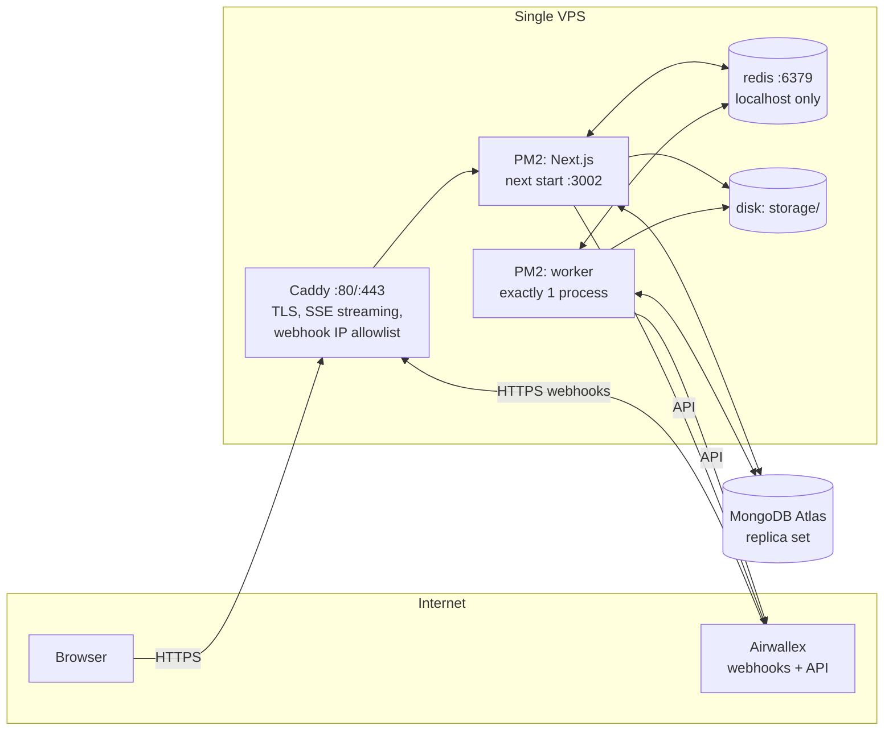

# 10 — Deployment

**Target:** one Linux VPS with this repo checked out. **PM2** runs the Next.js app (`pnpm start`) and the worker (`pnpm worker`). **Redis** runs on the host. **Caddy** terminates TLS and reverse-proxies to the app. **MongoDB** runs on **MongoDB Atlas** by default; a same-server `mongod` is described in §4.2. A Replit Reserved VM (§12) is the other demo host: Next.js, the worker, and Redis in one Replit container, Mongo still on Atlas.

`next build` writes the normal `.next` output, and `pnpm start` runs `next start` against the installed `node_modules` (including `tsx`, which the worker uses).

This is appropriate for a demo. It keeps operations simple, and the design already tolerates restarts: timers live in MongoDB, jobs persist in Redis, and payment calls are idempotent.

---

## 1. Topology



| Port | Exposed publicly | Service |
| --- | --- | --- |
| 22 | Yes (restrict to team IPs if possible) | SSH |
| 80, 443 | Yes | Caddy |
| 3002 | **No** (localhost only) | Next.js |
| 6379 | **No** (localhost only) | redis |

---

## 2. Server

| Item | Recommendation |
| --- | --- |
| Size | 2 vCPU, 4 GB RAM, 40 GB SSD (enough for the demo with headroom) |
| OS | Ubuntu 24.04 LTS |
| IP | Static public IP (needed for the Atlas IP access list) |
| DNS | `A` record, e.g. `fx-demo.<domain>` → server IP (Caddy needs it for certificates) |
| Clock | System time zone **UTC** and NTP enabled (`timedatectl set-timezone UTC`). All deadline logic uses `AIRWALLEX_ACCOUNT_TZ`, never the server time zone. |
| Firewall | `ufw default deny incoming`, then `ufw allow 22,80,443/tcp` |
| Runtime | Node.js 22, pnpm 10, PM2, Redis 7, Caddy 2 |
| Swap | 2 GB swap file (protects against Next.js build and memory spikes) |

---

## 3. Processes

Check the repo out (for example `/opt/fx-target`), copy `.env` from `.env.example`, and install the full lockfile. The worker script runs TypeScript through `tsx`, which is a devDependency, so this is `pnpm install --frozen-lockfile`, not a production-only install.

```bash
cd /opt/fx-target
pnpm install --frozen-lockfile
pnpm build
pm2 start npm --name awx-fx-target-payment -- start -- --port 3002
pm2 start npm --name awx-fx-worker --kill-timeout 60000 -- run worker
pm2 save
pm2 startup
```

`package.json` `"start"` is `next start`. The extra `--port 3002` is the port Caddy proxies to. `"worker"` is `node --env-file=.env --import tsx src/worker/index.ts`, so PM2's cwd must be the repo and `.env` must be there.

Run **one** worker process. Do not `pm2 scale` it. The poller and the sweeper must run exactly once (§5).

`NEXT_PUBLIC_*` values are inlined at **build** time. Change them, then `pnpm build` again, then `pm2 reload awx-fx-target-payment`.

---

## 4. Data stores

### 4.1 Redis

Redis 7 from the distro packages, bound to localhost, started by systemd.

```conf
# /etc/redis/redis.conf
bind 127.0.0.1
protected-mode yes
appendonly yes                # BullMQ jobs must survive restarts
appendfsync everysec
maxmemory 512mb
maxmemory-policy noeviction   # REQUIRED by BullMQ; evicting keys corrupts queues
save 900 1                    # RDB snapshot as a second safety net
requirepass <random 32+ chars>
```

`REDIS_URL=redis://:<password>@127.0.0.1:6379` in `.env`.

Client settings in `src/server/queue`:
- BullMQ `Worker` connections use `maxRetriesPerRequest: null` (BullMQ requires this for blocking commands).
- Use a separate connection for pub/sub subscribers, because a subscribed connection can't run other commands.
- Retain completed jobs `{ age: 86400, count: 1000 }` and failed jobs `{ age: 604800 }` so memory stays bounded.

### 4.2 MongoDB

**Option A: Atlas (default).**
- Cluster: **M0 (free)**, for development and the live demo (Q-08). It is a replica set, so transactions work, but it has shared resources, a small storage cap and throughput limits (check Atlas's current M0 limits). Keep within them:
  - Set `RATE_TICKS_TTL_DAYS=7` (default 30) so `rate_ticks` stays small; the 1-minute candles keep long-range charts.
  - Run the `stress` seed profile (200 bills) against a local MongoDB, not Atlas.
  - In B0, confirm on the actual cluster that time-series collections and `syncIndexes` work (`pnpm db:indexes`).
  - If the demo feels slow or throttled, move up to M10 or use Option B; nothing in the code changes.
- Region: the same region as the server (keeps latency under 5 ms).
- Network access: add the server's static IP only.
- Database user: least privilege (`readWrite` on `fxtarget`).
- `MONGODB_URI=mongodb+srv://<user>:<pass>@<cluster>/fxtarget?retryWrites=true&w=majority`
- Backups: Atlas continuous backup on M10+; on M0, run the `mongodump` cron below.

**Option B: same server.** Install MongoDB 7 and run it as a single-node replica set:
- `mongod --replSet rs0 --bind_ip 127.0.0.1 --auth`. Do not publish port 27017.
- Initialise with `rs.initiate({ _id: 'rs0', members: [{ _id: 0, host: '127.0.0.1:27017' }] })`.
- Budget 1 GB of RAM for it (so move to 8 GB RAM if Mongo shares the box).
- Nightly `mongodump --archive --gzip` via cron to off-box storage (S3/R2/B2), keeping 7 days.

### 4.3 Uploads

Bill documents live on the local disk under `storage/` in the checkout (`src/server/adapters/storage/local.ts`). Back that directory up nightly together with the Mongo dump. Sandbox-only data can skip backups if the team agrees.

---

## 5. Singleton worker

The **poller** and the **sweeper** must run exactly once. BullMQ job processing is safe to run in parallel, but a duplicate poller doubles the Airwallex rate-limit usage, and a duplicate sweeper races on timers. (The deterministic `jobId`s still prevent double execution.)

Two layers of protection:
1. **PM2:** one `awx-fx-worker` process, never scaled.
2. **Redis leader lock** in the worker: on boot, `SET worker:leader <instanceId> NX PX 15000`, renewed every 5 s. Only the lock holder starts the poller and sweeper. If the lock is lost, it stops them. BullMQ processors run regardless.

On deploy, reload the worker and give it up to 60 s (`--kill-timeout 60000`) to finish in-flight work before PM2 sends SIGKILL. The lock expires within 15 s even if a process dies without releasing it.

**Graceful shutdown (SIGTERM):**
1. Stop the poller and sweeper, and release the leader lock.
2. `await worker.close()` on every BullMQ worker, which waits for active jobs to finish.
3. Close the Redis and Mongo connections, then exit 0.

If a job is killed mid-flight anyway, BullMQ marks it stalled and retries it. Execution retries reuse the same Airwallex `request_id`, so a payment can never be created twice.

---

## 6. Reverse proxy (Caddy)

Caddy runs on the host and proxies to Next.js on localhost.

```caddyfile
# /etc/caddy/Caddyfile
fx-demo.example.com {
  encode zstd gzip

  # Live stream: no buffering, no compression, long-lived
  @sse path /api/stream
  handle @sse {
    reverse_proxy 127.0.0.1:3002 {
      flush_interval -1
      transport http {
        read_timeout 0
      }
    }
  }

  # Airwallex webhooks: only accept Airwallex IPs
  @webhook path /api/webhooks/airwallex
  handle @webhook {
    @notAirwallex not remote_ip 35.240.211.132 35.187.239.216 34.87.139.23 136.110.35.143 34.142.189.194 35.197.128.86
    respond @notAirwallex 403
    request_body { max_size 1MB }
    reverse_proxy 127.0.0.1:3002
  }

  # Optional: protect the whole demo host during rehearsals
  # basic_auth { demo <bcrypt-hash> }

  handle {
    request_body { max_size 25MB }   # bill uploads (≤ 20 MB per file + multipart overhead)
    reverse_proxy 127.0.0.1:3002
  }

  header {
    Strict-Transport-Security "max-age=31536000"
    X-Content-Type-Options nosniff
    Referrer-Policy strict-origin-when-cross-origin
    -Server
  }
}
```

The allowlist above is the **sandbox** webhook IP list from Airwallex's ["Listen for webhook events"](https://www.airwallex.com/docs/developer-tools/webhooks/listen-for-webhook-events#whitelist-ip-addresses) page. For production, replace it with the production list from the same page and re-check it before each go-live.

**App-side requirements for SSE** (`src/app/api/stream/route.ts`):
- `export const runtime = 'nodejs'` and `export const dynamic = 'force-dynamic'`
- Response headers: `Content-Type: text/event-stream`, `Cache-Control: no-cache, no-transform`, `Connection: keep-alive`, `X-Accel-Buffering: no` (the last one helps if nginx is used instead of Caddy)
- Heartbeat comment (`: ping`) every 15 s so idle connections aren't dropped
- Clean up the Redis subscription on `request.signal` abort

**Webhook route requirement:** read the raw body with `await request.text()` before any parsing, so HMAC verification works. Caddy passes the body through unchanged.

---

## 7. Secrets & configuration

- `/opt/fx-target/.env` holds all variables from [02 §8](./02-architecture.md#8-environment-variables). Owner is the deploy user, `chmod 600`, never committed. Keep a copy in the team password manager.
- Production-specific values:
  - `NODE_ENV=production`
  - `DEMO_MODE=true` on the demo host only. It enables `/dev/*` and `/api/demo/*`, so pair it with Caddy `basic_auth` when the host is public.
  - `AIRWALLEX_ENV=sandbox` for the demo. Switching to production also requires production API keys, the production webhook secret, the production IP allowlist, and `DEMO_MODE=false`.
  - `SPEND_SYNC` and `FILES_UPLOAD` stay `false` unless those stretch goals are turned on.
  - `NEXT_PUBLIC_*` values are baked in at **build time**, so rebuild when they change.
- Airwallex: use a **scoped** API key and, if possible, restrict it to the server's static IP in the Airwallex web app (see Airwallex's "API key best practices").
- Rotate the Redis password, the Mongo user password and the Airwallex key after the demo if the host was shared widely.

---

## 8. Deploy procedure

**First-time setup**
1. Provision the server (§2). Install Node 22, pnpm, PM2, Redis, and Caddy. Clone the repo to `/opt/fx-target` and write `.env`.
2. Point DNS at the server and wait for it to resolve (Caddy issues the certificate on first start).
3. Set up the Atlas cluster, user and IP access list (or Option B).
4. Start Redis and confirm `redis-cli ping` returns `PONG`.
5. `pnpm install --frozen-lockfile && pnpm build && pnpm db:indexes`
6. Start both PM2 processes (§3) and `pm2 save`.
7. In the Airwallex sandbox web app under **Developer → Webhooks**, register `https://fx-demo.example.com/api/webhooks/airwallex`, select the events from [04 §3](./04-airwallex-integration.md#3-webhooks) and the API version equal to `AIRWALLEX_API_VERSION`, and put the secret into `.env`. Then `pm2 reload awx-fx-target-payment` so the app picks it up.
8. Run `pnpm airwallex:smoke` and confirm V1–V10 pass from the server.
9. Seed: `pnpm seed:demo` (and `pnpm seed:beneficiaries` first, if the account has no beneficiaries).

**Routine deploy**
```bash
cd /opt/fx-target
git pull
pnpm install --frozen-lockfile
pnpm build
pnpm db:indexes          # idempotent
pm2 reload awx-fx-target-payment
pm2 reload awx-fx-worker
pm2 save
curl -fsS https://fx-demo.example.com/api/health
```

What users see during a deploy: web is unavailable for a few seconds while Next.js restarts. Open SSE streams drop and reconnect automatically, and the UI shows "Reconnecting…" briefly. The worker waits for in-flight jobs to finish (up to the 60 s kill timeout). Timers that became due during the gap fire on the first sweep.

**Rollback:** `git checkout` the previous commit, then the same install, build, and `pm2 reload`. Index syncs are additive, and there are no destructive migrations in the demo scope.

**Avoid deploying during a live demo or near a bill's deadline window.** Check the Approvals tab and the `timers` in `/dev/market` first.

---

## 9. Health, logs & monitoring

| Signal | How |
| --- | --- |
| `/api/health` | Returns 200 only if Mongo ping, Redis ping, worker heartbeat (`worker:heartbeat` key < 30 s old), and Airwallex token are OK. Otherwise 503. The body includes feed freshness per active pair and queue depths. `PAYMENTS_GATEWAY=mock` reports the token check ok without a login. |
| Process health | `pm2 status`. Restart policy is PM2's default (`autorestart`). |
| Uptime | External monitor (UptimeRobot, Better Stack) on `/api/health` every 1 min, alerting you by email (ops only; the app itself has no out-of-band alerts) |
| Logs | pino JSON to stdout. View with `pm2 logs awx-fx-worker`. Optionally ship to Better Stack or Grafana Loki. |
| Queues | Failed-job counts per queue on the `/dev/market` ops panel; alert if the `execution` or `webhook` queues have failures |
| Disk | Alert at 80% (Redis AOF, `storage/`, logs) |

---

## 10. Failure modes on a single server

| Failure | Impact | Mitigation |
| --- | --- | --- |
| Server reboot | Everything is down for about 1 min | `pm2 startup` plus Redis and Caddy under systemd bring it back; Redis AOF restores jobs; the sweeper catches up on timers |
| Worker crash loop | No ticks, triggers or deadlines | Health alert; fix and `pm2 reload awx-fx-worker`. For deadline guarantees during long outages, enable `DEADLINE_SAFETY_NET=airwallex` (Airwallex-side scheduled transfer, [01 §5](./01-feasibility-airwallex.md#5-deadline-guarantee-two-layers)) |
| Redis data loss | Queued jobs lost | Timers are in Mongo, so they are re-enqueued automatically. In-flight executions are recovered by the reconciler through `GET /transfers/{id}` |
| Atlas outage | App errors | Rare. The UI shows a banner; nothing is executed without the DB |
| Webhook delivery failing (certificate, allowlist, downtime) | Stale transfer statuses | Airwallex retries for about 3 days; the reconciler polls every 60 s regardless |
| Disk full | Redis stops writing, uploads fail | Disk alert, completed-job retention limits |

---

## 11. Pre-demo checklist

- [ ] `curl https://<host>/api/health` returns 200, and every component is green
- [ ] `pnpm airwallex:smoke` passes from the server
- [ ] The Airwallex test webhook arrives (check the Airwallex web app's delivery log)
- [ ] `redis-cli CONFIG GET maxmemory-policy` returns `noeviction`
- [ ] Exactly one worker holds `worker:leader`, and `pm2 list` shows a single `awx-fx-worker`
- [ ] No deploys are scheduled; the checkout is on the commit you intend to demo
- [ ] A backup was taken after seeding
- [ ] `DEMO_MODE=true` and basic auth are configured as intended for the audience

---

## 12. Replit

Replit imports the repo and publishes one container. [`.replit`](../.replit) builds with pnpm and runs [`scripts/replit-start.sh`](../scripts/replit-start.sh), which starts Redis (unless `REDIS_URL` is already an external URL), syncs indexes, starts the worker, then binds Next.js to `0.0.0.0` and `PORT`. MongoDB stays on **Atlas**. The numbered steps are also in the [README](../README.md).

Publish as a **Reserved VM with one instance**. Autoscale is the wrong target for this app:

- It can scale to zero. The worker stops, so nothing watches rates or pays at the cutoff, and a webhook that arrives during a cold start is missed until Airwallex retries.
- It can scale past one instance. The script's Redis is local to the container, so each copy is its own leader and can pay the same bill twice.

Leave `REDIS_URL` unset on that VM. The script listens on `127.0.0.1:6379` with `maxmemory-policy noeviction` and an AOF under `.data/redis` (gitignored). Set `REDIS_URL` only when Redis is hosted elsewhere (Upstash, Redis Cloud); the script then skips the local server. A hosted Redis still needs a single worker, so the VM stays at one instance.

`NEXT_PUBLIC_DATA_SOURCE=api` is inlined at **build** time. Set it on the deployment before the first publish, and again after any change, or the UI stays on the in-browser mock. On Atlas M0 set `RATE_TICKS_TTL_DAYS=7` (§4.2).

Workspace Secrets are not copied into a deployment. Put the same values in both. The editor Run button (`pnpm replit:dev`) starts Redis, the worker, and `next dev` when `MONGODB_URI` is set, and Next.js alone when it is not.

Seed from a machine that has the repo, not from the Replit shell. Point `.env` at the same Atlas URI and run `pnpm seed:beneficiaries` and `pnpm seed:demo`. Register the webhook on the published host: `https://<slug>.replit.app/api/webhooks/airwallex`. The `*.replit.dev` editor URL is not that host.
