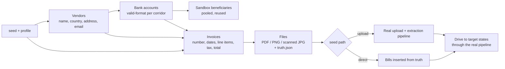

# 11 — Test Data & Seeding

**Goal:** a single command gives any developer, tester or rehearsal a realistic set of vendors, vendor bank accounts (Airwallex sandbox beneficiaries), invoice PDFs and bills in whatever states they need. Output is reproducible from a seed and safe to re-run.

This sits alongside the curated demo seed (`pnpm seed:demo`, the three scripted bills in [08 §2](./08-demo-plan.md#2-demo-bills)). The curated seed is for the stage. The generator is for everything else: development, QA, extraction accuracy, edge cases and load.

---

## 1. What gets generated



| Artefact | Details |
| --- | --- |
| **Vendor** | Company name, legal suffix (GmbH, Ltd, Pvt Ltd, Pte Ltd, K.K., Pty Ltd), address and phone for the country locale, `billing@<slug>.example` email (RFC 2606 domain), tax ID in the country's format, and an invoice-number style |
| **Bank account** | Corridor-specific fields in a valid format with valid checksums: IBAN (mod-97) for EUR/CHF, sort code + 8-digit account for GBP, IFSC + account for INR, BSB + account for AUD, bank/branch codes for JPY/SGD/HKD, and so on. Bank identifiers come from a small **allowlist per corridor** that the sandbox accepts (V12); account numbers and names are random on top. The 2026-10-04 run accepted EUR `37040044` / `COBADEFFXXX`, GBP sort code `200000`, JPY SWIFT `BOTKJPJT`, SGD SWIFT `DBSSSGSG`, and INR IFSC `HDFC0000001`. The other corridors are still format-only |
| **Beneficiary** | Created in the Airwallex sandbox from the vendor + bank account, using the API schema for the corridor ([04 §2.6](./04-airwallex-integration.md#26-beneficiaries)). **Pooled**: each corridor keeps up to `BENEFICIARY_POOL_SIZE` (default 4) generated vendors, reused across runs, so the sandbox doesn't fill up with hundreds of beneficiaries |
| **Invoice** | Invoice number, issue date, due date (distribution by profile), payment terms, 1–8 line items (qty × unit price), tax at the country rate, subtotal/tax/total exact at the currency precision, payment reference, the vendor's bank details, and "notes" noise |
| **Files** | The invoice rendered to PDF, and optionally to PNG or a degraded "scanned" JPG, plus a `*.truth.json` sidecar with the ground-truth fields |
| **Bill** | A bill in the target state, either through the real upload + extraction flow or inserted directly from the truth file |

---

## 2. Profiles

| Profile | Bills | What it's for | Default path | Gateway |
| --- | --- | --- | --- | --- |
| `mixed` (default) | 12 across EUR, GBP, JPY, SGD, AUD, INR | Everyday development: 2 `DRAFT`, 2 `READY`, 5 `WATCHING` (targets 0.1–0.3%, 0.8% and 3% away), 1 `PAUSED`, 1 `EXECUTING`, 1 `PAID` | direct | `airwallex` (sandbox) |
| `lifecycle` | One per `BillState` | The live analogue of the C0.3 fixtures; every ticket state visible at once | direct + pipeline | `airwallex` |
| `deadline` | 6 | Execution deadline today / tomorrow / +2 business days, over a weekend, LOCAL vs SWIFT lead days, in `AIRWALLEX_ACCOUNT_TZ`. Pair with the warp clock | direct | `airwallex` |
| `corridors` | One per enabled corridor | Beneficiary creation and transfers per corridor, including buy-only (INR, PHP, IDR), 0-dp (JPY) and SWIFT-only corridors | direct + pipeline | `airwallex` |
| `extraction` | 0 (files only) | 30+ invoices across every template × variant with truth files, scored by `pnpm test:extraction` | files only | — |
| `upload` | 5 files | Manual QA of the upload → review → arm flow, including one low-quality scan and one missing-bank-details invoice | upload | `airwallex` |
| `stress` | 200 across 20 pairs | List virtualisation, SSE fan-out, chart switching, poller batching | direct | **`mock` forced**, and `RATE_SOURCE=simulated` forced |
| `e2e` | 6, fixed seed 1 | What Playwright runs against, on both `mock` and `api` data sources | direct | per test run |

Custom mixes are possible with flags (`--count`, `--currencies`, `--states`, `--due-in`), which override the profile.

---

## 3. Reaching bill states honestly

Bills are only ever put into states that match reality in the sandbox. **We never write fake Airwallex IDs into a sandbox-backed database.**

| Target state | How the seeder gets there |
| --- | --- |
| `DRAFT` | Insert with the extraction result (direct), or upload the file and stop after extraction (upload path) |
| `READY` | `DRAFT` + resolve the beneficiary (from the pool) + mark the fields reviewed, through the normal services |
| `WATCHING` | `READY` + strategy + standing instruction + `arm` service. The target is set relative to the current price by a profile rule (e.g. "0.8% below entry") |
| `PAUSED` | `WATCHING` + `pause` |
| `EXECUTING` | Pay now, a target hit, or the cutoff. The seeder stops before the transfer leaves `SCHEDULED` |
| `IN_FLIGHT` | A Simulate run ([08 §1.1](./08-demo-plan.md#11-simulate-button)) with transfer advance stopped at `SENT` |
| `PAID` | A full Simulate run |
| `FAILED` | A Simulate run with the transfer advanced to `FAILED` (sandbox simulation `failure_type`) |
| `CANCELLED` | `READY` or `WATCHING` + `cancel` |

With `--gateway mock` (and always in `stress`), the same steps run against the mock gateway, which is instant and makes no Airwallex calls.

---

## 4. Invoice rendering

**Templates** (`scripts/generate/templates/*.tsx`, React + Tailwind, rendered to HTML):

| Template | Look |
| --- | --- |
| `classic` | Letterhead, boxed line-item table, totals bottom-right, bank details in the footer |
| `modern` | Coloured header band, two-column meta, bank details in a side panel |
| `minimal` | Plain text-heavy layout, no table borders |
| `locale` | Local-language labels (German "Rechnung", "Fällig am"; Japanese 請求書) and local date formats |

**Variants** (applied on top of a template, mainly for the `extraction` profile):

| Variant | Tests |
| --- | --- |
| `clean` | Baseline |
| `scanned` | Rasterised, rotated 0.5–2°, noise, slight blur, JPEG quality 60–75 |
| `multi-page` | Line items spill onto page 2; the total is on page 2 |
| `ambiguous-dates` | `03/04/2026`-style dates where DD/MM vs MM/DD matters (resolved by vendor country) |
| `multiple-amounts` | Subtotal, tax, total, "amount paid" and "balance due" all present |
| `epc-qr` | EUR invoices carry an EPC (SEPA GiroCode) payment QR; `conflicting-qr` puts a different IBAN in the QR than in the text (the CONFLICT warning must show) |
| `factur-x` | PDF/A-3 with embedded Factur-X/ZUGFeRD XML (the deterministic path must win) |
| `missing-bank` | No bank details (the review screen must ask for them) |
| `duplicate` | Same vendor + invoice number as an existing bill (the duplicate warning must show) |
| `foreign-home` | An invoice already in the home currency (must be rejected or flagged, since there's nothing to convert) |

**Rendering:** Playwright (already a dev dependency) loads the HTML and prints it to PDF with fixed metadata dates, so the same seed gives the same bytes. The same page is screenshotted for PNG variants, and `sharp` degrades images for `scanned`.

`pnpm gen:invoices` currently writes `*.truth.json` and a one-page text PDF of those fields. The Playwright templates and `sharp` scans are not generated yet. `sharp` is not a dependency; adding it needs a D-xx first.

**Truth sidecar** (`INV-….truth.json`):
```json
{
  "generatorVersion": 1,
  "seed": 42,
  "index": 3,
  "template": "modern",
  "variant": "clean",
  "vendor": { "name": "Kessler Maschinenbau GmbH", "country": "DE", "email": "billing@kessler-maschinenbau.example" },
  "invoiceNumber": "KM-2026-0147",
  "currency": "EUR",
  "subtotal": "210084.03",
  "tax": "39915.97",
  "total": "250000.00",
  "issueDate": "2026-09-28",
  "dueDate": "2026-10-28",
  "bank": { "iban": "DE89370400440532013000", "bic": "COBADEFFXXX", "accountName": "Kessler Maschinenbau GmbH" },
  "lineItems": [{ "description": "CNC spindle assembly", "qty": "3", "unitPrice": "70028.01", "amount": "210084.03" }]
}
```

**Mock extractor:** `BILL_EXTRACTOR=mock` looks the uploaded file up by SHA-256 in `generated/index.json` and returns its truth. It lowers the confidence on 1–2 fields (deterministically, from the seed) so the review UX gets exercised. Unknown files get a canned extraction. Tests and rehearsals can therefore run the whole upload flow without an LLM.

**Extraction accuracy:** `pnpm test:extraction --profile extraction --seed 7` runs the real extraction pipeline (`anthropic`, or `ollama` for comparison) over the generated files and prints per-field accuracy by template and variant. The gates are defined in [12 §5](./12-bill-extraction.md#5-benchmark-and-gates). Misses are written to a report for prompt tuning (B4.2b).

---

## 5. Determinism, idempotency and cleanup

- **One seeded PRNG** drives everything (Faker seeded + our own `rng`). The same `seed` + `generatorVersion` produces the same vendors, invoices, files and bill plan.
- **`seedKey`** on each generated bill: `gen:v{generatorVersion}:{seed}:{index}` (unique, sparse). Re-running the same seed skips existing bills. `--fresh` picks a new random seed and prints it so a run can be reproduced.
- Beneficiaries are keyed by `gen:bf:{corridor}:{poolSlot}` and reused from our database. `POST /beneficiaries/create` has no `request_id`, so a retried create can insert a second beneficiary on Airwallex. Transfer `request_id`s stay deterministic from the bill seed key.
- Generated bills are marked `generated: true`, and demo mode shows a small "GEN" chip on them.
- **Cleanup:** `pnpm db:reset` drops every application collection (including beneficiaries and rate ticks), obliterates the BullMQ queues, and resets the demo clock and market. It requires `DEMO_MODE=true`. Run `pnpm db:indexes` afterwards. `pnpm seed:reset --generated` removes generated bills, their events, executions and files, and keeps beneficiaries. `pnpm seed:reset --shared-sim` deletes shared ticks from `RATE_SOURCE=simulated` (no `simId`) and leaves Simulate-session ticks in place. In-flight sandbox transfers are cancelled first when still cancellable.

---

## 6. Funding

Before a run that will execute payments (`lifecycle`, `corridors`, or `mixed` with a `PAID` bill), the seeder:
1. Estimates the home-currency cost of the bills it will execute, plus a 20% buffer.
2. Reads `GET /balances/current`.
3. If short, tops up with the sandbox deposit simulation (V13), or stops with a clear message and the amount needed.

---

## 7. Interfaces

**CLI**
```bash
pnpm gen:invoices --profile extraction --seed 7 --out generated/invoices   # files only, no DB or Airwallex
pnpm seed:generate                                  # profile mixed, random seed (printed)
pnpm seed:generate --profile lifecycle --seed 42
pnpm seed:generate --profile deadline --gateway mock
pnpm seed:generate --count 20 --currencies EUR,INR --states WATCHING --due-in 3..10 --via upload
pnpm seed:generate --dry-run                        # print the plan table, change nothing
pnpm seed:reset --generated
pnpm seed:reset --shared-sim                       # drop the old shared random-walk ticks
pnpm test:extraction --seed 7
```

**Demo UI** (`DEMO_MODE=true`):
- `/dev/market` → **Test data** panel: choose a profile, seed and count; generate; list generated batches with a reset button per batch.
- Upload modal → **Add sample invoices** (1–5): the server generates files with the `upload` profile rules and drops them into the upload queue as if the user had dragged them in. This makes the upload flow testable in seconds.
- API: `POST /api/demo/generate { profile, seed?, count?, via? }` → `{ batchId, seed, plan }`, with progress over SSE (`notification` events).

**Mock mode:** the data generators are pure TypeScript and browser-safe (`src/mocks/generators`), so the mock `DataSource` can build a `stress` or `mixed` set in memory from a seed. File rendering and Airwallex calls are script/server-only.

---

## 8. Code layout

```
src/mocks/generators/            # pure, browser-safe, unit-tested
  rng.ts                         # seeded PRNG + helpers (pick, weighted, range, decimal amounts)
  corridors.ts                   # currency → country, methods, bank-field generators, allowlisted bank ids, amount ranges, tax rate
  vendors.ts                     # company, address, email, tax id, invoice-number style
  bankDetails.ts                 # IBAN (mod-97), sort code, IFSC, BSB, … with checksums
  invoices.ts                    # line items, tax, totals at currency precision, dates by profile
  profiles.ts                    # profile definitions → bill plan (target states, due dates, target distances)
scripts/generate/
  templates/*.tsx                # invoice templates
  render.ts                      # HTML → PDF/PNG (Playwright), degrade (sharp), truth sidecar, index.json
  gen-invoices.ts                # pnpm gen:invoices
  seed-generate.ts               # pnpm seed:generate (uses server services to reach states)
  reset-generated.ts
generated/                       # output (gitignored)
```

Generators reuse `src/contracts/currencies.ts` for precision and `decimal.js` for amounts. The seeder reaches states only through `src/server/services` (see §3), never by writing states directly.

**Unit tests:** totals equal the line items at currency precision; checksums are valid; due date ≥ issue date; the same seed gives an identical data snapshot; every profile's plan only uses enabled corridors.

---

## 9. Safety

- Refuses to run unless `AIRWALLEX_ENV=sandbox` (or the gateway is `mock`) and `DEMO_MODE=true`.
- All data is fictional: Faker names, `.example` email domains, and fake addresses and tax IDs. Everything is tagged `DEMO-ONLY:`. Bank identifiers are limited to the sandbox allowlist.
- Airwallex calls go through the normal client and limiter. Large runs (`stress`) always use the mock gateway, so they never burn sandbox rate limits.
