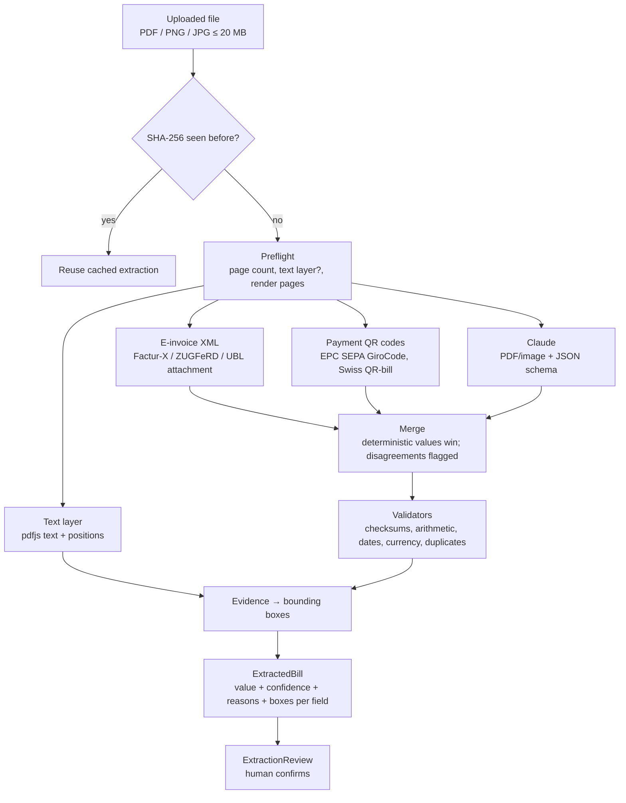

# 12 — Bill Extraction

**Decision:** extraction runs as a pipeline. Deterministic readers go first (embedded e-invoice XML, payment QR codes, the PDF text layer). **Claude via the Anthropic API** fills in the rest with schema-constrained JSON. Validators then check every field, and a human always reviews the result before a bill can be armed (D-15). A local model (Ollama) is an optional adapter for offline development, not the default. `mock` returns generator truth for tests ([11 §4](./11-test-data-and-seeding.md#4-invoice-rendering)).

Airwallex offers no extraction API (OCR exists only in its web app, [01 R2](./01-feasibility-airwallex.md#1-requirement--capability-map)), so this is ours to build.

---

## 1. Options considered

| Option | Accuracy on varied layouts | Scans / photos | Cost | Runs on our 2 vCPU / 4 GB server | Verdict |
| --- | --- | --- | --- | --- | --- |
| **Claude (Anthropic API)**: PDF sent as a `document` block, JSON-schema output | High; reads text *and* page images, tables, multiple languages | Good | A few thousand input tokens per page; negligible at demo volume | Yes (outbound HTTPS only) | **Default** |
| Local VLM via Ollama (a current Qwen vision model, 7–8B class), with Ollama's JSON-schema `format` | Good on clean invoices, weaker on messy scans; can invent numbers | OK | Free per call; needs a GPU or Apple Silicon with ≥ 16 GB | **No**: CPU-only inference is far too slow, and RAM is too small | Optional `ollama` adapter for offline development and data-residency experiments |
| Docling / Marker (layout + tables to Markdown/JSON) + an LLM for field mapping | Good structure, but still needs an LLM for fields | Needs an OCR engine | Python sidecar | Heavy | Not worth a second runtime for the demo |
| Tesseract / PaddleOCR + regex rules | Brittle across vendors | Tesseract is weak on skewed scans | Free | Tesseract yes | Rules only for the deterministic checks below |
| Template tools (invoice2data) | Perfect for known vendors, useless for new ones | — | Free | Yes | No: our vendors are arbitrary |

**Why Claude as the default:** it handles every template and variant in the generator (scanned, multi-page, locale labels, ambiguous dates) with one prompt. It returns schema-valid JSON through structured outputs, so there's no parse-and-retry loop. It needs no GPU, so it fits the single-server deployment ([10](./10-deployment.md)). Local models only win when invoices must not leave our infrastructure. For the demo they're fictional ([11](./11-test-data-and-seeding.md)); for real invoices, confirm Anthropic's data-retention terms (zero-data-retention eligibility) before going live.

---

## 2. Pipeline



### 2.1 Preflight
- Accept PDF, PNG, JPG (≤ 20 MB). Process the first `EXTRACTION_MAX_PAGES` pages (default 3). Encrypted PDFs are rejected with a clear message.
- Render pages to PNG (`pdfjs-dist` + `@napi-rs/canvas`, which has prebuilt musl binaries for the Alpine image) for QR decoding and the review preview.
- Record whether a text layer exists (born-digital vs scanned).

### 2.2 Deterministic readers (free, exact, instant)

| Reader | Gives | Confidence |
| --- | --- | --- |
| **E-invoice XML** embedded in the PDF (Factur-X/ZUGFeRD CII, XRechnung, UBL), read with `pdfjs` `getAttachments()` + `fast-xml-parser` | Vendor, invoice number, dates, currency, totals, tax, IBAN/BIC, payment reference | `high` |
| **Payment QR** decoded with `zxing-wasm`: EPC069-12 (SEPA GiroCode) and Swiss QR-bill | IBAN, BIC, beneficiary name, amount, currency, reference | `high` |
| **Text layer**: regexes for IBAN, SWIFT/BIC, IFSC, sort code, ISO currency codes | Candidates used to cross-check the LLM, plus positions for highlights | Not a source on its own |

### 2.3 Claude
- **Request:** Messages API with the PDF as a `document` block (base64) or the image as an `image` block, plus the prompt and `output_config.format = { type: 'json_schema', schema }`. The schema is generated from the zod `ExtractedBillLLM` schema in `src/contracts`.
- **Models:** `EXTRACTION_MODEL` (default `claude-haiku-4-5`: fast and cheap) with an **escalation** to `EXTRACTION_MODEL_STRONG` (default `claude-sonnet-5`). Escalate when any required field is missing or `low`, when validators fail, or when the file is a scan. The final defaults are picked by the benchmark in §5.
- **Prompt rules** (versioned in `src/server/adapters/extraction/prompt.ts`, `PROMPT_VERSION`):
  - Extract the **amount due** (balance due after any payments), not the subtotal.
  - Resolve ambiguous dates using the vendor's country; if still ambiguous, return both candidates and `low`.
  - Never guess: return `null` with a reason instead of inventing a value.
  - For every field, return `evidence`: a verbatim snippet copied from the document, plus the page number.
  - Classify the document (`invoice`, `credit_note`, `receipt`, `statement`, `quote`, `other`). Anything other than an invoice is flagged.
- **Why `evidence` instead of Claude citations:** citations can't be combined with structured outputs (the API rejects the combination), and LLMs are poor at producing pixel coordinates. We ask for verbatim snippets and locate them ourselves (§2.5).
- **Runtime:** runs in the worker's `extraction` queue (concurrency 4), 60 s timeout, retries `429`/`5xx`/`overloaded` with backoff. Token usage is logged per document.

### 2.4 Merge and validate
- Deterministic values override LLM values. When they disagree (e.g. the QR IBAN ≠ the LLM's IBAN), keep the deterministic value, set the field to `medium`, and add the reason "document shows two different IBANs".
- Validators (each failure downgrades the field and attaches a reason shown in the review UI):

| Check | Rule |
| --- | --- |
| Currency | ISO 4217, payable per `src/contracts/currencies.ts`, **≠ home currency** |
| Amount | > 0, valid precision for the currency, equal to subtotal + tax (± 1 minor unit) when all three are present, equal to the QR amount when present |
| Dates | Issue ≤ due; due not more than 1 year out; a past due date is flagged "overdue" (arming goes straight to the deadline window) |
| Bank details | IBAN mod-97, BIC format, IFSC/sort code/BSB formats per corridor; account holder name similar to the vendor name |
| Duplicates | Same vendor + invoice number (+ amount) as an existing bill → warning |
| Document type | Not `invoice` → blocking warning |

### 2.5 Evidence → highlights
For born-digital PDFs, each field's `evidence` is fuzzy-matched (normalised whitespace, number formats) against the `pdfjs` text items on the stated page. The matched items' rectangles become that field's `boxes`, which `ExtractionReview` draws on the preview. Scans have no text layer, so fields show without highlights. The QR and XML sources get a label ("from payment QR code") instead.

### 2.6 Confidence and review UX
| Level | Source | Review UI |
| --- | --- | --- |
| `high` | Deterministic reader, or LLM `high` with all validators passing | Plain, pre-filled |
| `medium` | LLM `medium`, or a disagreement resolved deterministically | Amber highlight; "check" hint with the reason |
| `low` / missing | LLM `low`/`null`, or a failed validator | Red; must be confirmed or filled before "Continue" |

The human review is always required, whatever the confidence ([07 §3](./07-pages-spec.md)).

---

## 3. Contract

```ts
type Confidence = 'high' | 'medium' | 'low';
type FieldSource = 'xml' | 'qr' | 'llm' | 'user';

interface ExtractedField<T = string> {
  value: T | null;
  confidence: Confidence;
  source: FieldSource;
  reasons?: string[];                       // validator / disagreement messages
  evidence?: { page: number; text: string };
  boxes?: Array<{ page: number; x: number; y: number; w: number; h: number }>;   // page-relative 0..1
}

interface ExtractedBill {
  documentType: 'invoice'|'credit_note'|'receipt'|'statement'|'quote'|'other';
  vendorName: ExtractedField;
  vendorCountry: ExtractedField;           // ISO 3166-1 alpha-2
  invoiceNumber: ExtractedField;
  currency: ExtractedField;
  amountDue: ExtractedField;               // decimal string, major units
  subtotal?: ExtractedField; tax?: ExtractedField;
  issueDate: ExtractedField; dueDate: ExtractedField;   // ISO dates
  paymentReference?: ExtractedField;
  bank: {
    accountName?: ExtractedField; iban?: ExtractedField; bic?: ExtractedField;
    accountNumber?: ExtractedField; localBankCode?: ExtractedField;   // sort code / IFSC / BSB / routing
    bankCountry?: ExtractedField;
  };
  warnings: Array<{ code: 'DUPLICATE'|'NOT_INVOICE'|'HOME_CURRENCY'|'OVERDUE'|'CONFLICT'|'UNREADABLE'; message: string }>;
  meta: { extractor: 'anthropic'|'ollama'|'mock'; model?: string; promptVersion: string; escalated: boolean; pages: number; textLayer: boolean; ms: number; inputTokens?: number; outputTokens?: number };
}
```

`bill_documents.extraction` stores this, plus `sha256` (indexed) for the cache.

---

## 4. Configuration

```bash
BILL_EXTRACTOR=anthropic                 # anthropic | ollama | mock
ANTHROPIC_API_KEY=
EXTRACTION_MODEL=claude-haiku-4-5
EXTRACTION_MODEL_STRONG=claude-sonnet-5
EXTRACTION_MAX_PAGES=3
EXTRACTION_ESCALATE=true
OLLAMA_URL=http://localhost:11434        # ollama adapter only
OLLAMA_MODEL=                            # a vision model that supports JSON-schema format
```

The key is server-side only (worker). The demo deployment needs outbound HTTPS to `api.anthropic.com` and no other changes.

---

## 5. Benchmark and gates

`pnpm test:extraction --seed 7` runs the `extraction` profile from [11](./11-test-data-and-seeding.md) (every template × variant with truth files) and prints per-field accuracy, escalation rate, latency (p50/p95) and tokens per document, broken down by extractor and model.

| Gate (default config) | Target |
| --- | --- |
| Currency, amount due, due date on `clean` | ≥ 98% exact |
| Same fields on `scanned` | ≥ 90% exact |
| IBAN / account number (when present) | ≥ 98% exact; checksum failures are always caught by the validators |
| Hallucinated values (value present, wrong, and marked `high`) | 0 on amount, currency and IBAN |
| p95 latency per document | < 15 s (upload UX shows progress) |

Run it for Haiku-only, Haiku→Sonnet escalation and Sonnet-only, and pick the cheapest configuration that passes. Record the result in [09](./09-decisions-and-open-questions.md) (D-15).

---

## 6. Code layout

```
src/server/adapters/extraction/
  index.ts            # BillExtractor factory from BILL_EXTRACTOR
  pipeline.ts         # preflight → deterministic → LLM → merge → validate → boxes
  preflight.ts        # page count, text layer, page renders
  einvoice.ts         # Factur-X / ZUGFeRD / UBL attachment parser
  qr.ts               # EPC + Swiss QR decode
  textLayer.ts        # pdfjs text items, regex candidates, evidence → boxes
  validators.ts       # pure, unit-tested
  anthropic.ts        # Messages API call, structured output, escalation
  ollama.ts           # optional local adapter (same schema)
  mock.ts             # truth by SHA-256 (generator) or canned
  prompt.ts           # PROMPT_VERSION + prompt text
```
