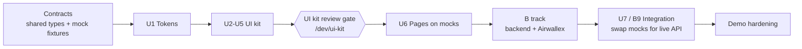

# FX Target Payment — Internal Docs

Internal implementation documentation for the **FX Target Payment** demo built on Airwallex.

> Enter a foreign-currency bill, set a target FX rate or maximum cost, and submit. The system watches the rate and pays when the target is hit. If the target is not hit, it pays at market at the execution-deadline cutoff.

The product is presented like a **perps trading terminal**: every bill is a "position" with its own chart of the currency pair, horizontal lines for **entry** and **target**, and vertical lines for the **execution deadline** and **due date**. Multiple bills can be uploaded and switched between like markets/positions.

## Reading order

| # | Doc | What it answers |
| --- | --- | --- |
| 00 | [Product brief](./00-product-brief.md) | What we are building, for whom, the perps metaphor, scope and non-goals |
| 01 | [Feasibility review (Airwallex)](./01-feasibility-airwallex.md) | Can Airwallex do this? Capability map, constraints, risks, verdict |
| 02 | [Architecture](./02-architecture.md) | System components, stack, repo layout, runtime topology |
| 03 | [Domain model](./03-domain-model.md) | Bill lifecycle state machine, rate math, trigger rules, DB schema |
| 04 | [Airwallex integration spec](./04-airwallex-integration.md) | Endpoint-by-endpoint contract, webhooks, idempotency, sandbox setup |
| 05 | [Design system](./05-design-system.md) | Visual language: matte ruled sheet, flat orange, bottom grain aurora, tokens, motion, charts |
| 06 | [UI kit spec](./06-ui-kit-spec.md) | Every component, its variants and states, and the `/dev/ui-kit` page |
| 07 | [Pages spec](./07-pages-spec.md) | Terminal layout, flows, screens assembled from the kit |
| 08 | [Demo plan](./08-demo-plan.md) | Demo mode, market simulator, scripted scenarios, run-of-show, demo-vs-production inventory |
| 09 | [Decisions & open questions](./09-decisions-and-open-questions.md) | ADR-style log, open items to confirm with Airwallex |
| 10 | [Deployment](./10-deployment.md) | One VPS: full checkout, PM2 for Next.js and the worker, Redis on the host, Caddy, MongoDB Atlas. Replit Reserved VM in §12 |
| 11 | [Test data & seeding](./11-test-data-and-seeding.md) | Seeded generator for vendors, bank accounts, sandbox beneficiaries, invoice PDFs and bills in any state; profiles, extraction accuracy tests |
| 12 | [Bill extraction](./12-bill-extraction.md) | Deterministic readers (e-invoice XML, payment QR, text layer) + Claude structured output + validators + review; options compared; accuracy gates |
| 13 | [Airwallex → Contracts & UI](./13-airwallex-contracts.md) | Field-level map from the Airwallex API to our contracts and components: wire conventions, precision, error codes, transfer/funding statuses, fees, beneficiary form schemas and verification, reference data |

Agent and contributor rules: [`AGENTS.md`](../AGENTS.md) (hard rules, commands, commit policy) and `.cursor/rules/*.mdc` (scoped rules per area: Airwallex client, bill state and money, worker and queues, webhooks, UI kit, Next.js data, scripts, deployment, comment tags, commits).

## Tracks

Work is split into two tracks. IDs (`U1.3`, `B4.2`, ...) are used in PRs, commits and tickets.

| Track | Doc | Scope |
| --- | --- | --- |
| **U — UI** | [tracks/U-track.md](./tracks/U-track.md) | Design tokens → UI kit → `/dev/ui-kit` review gate → pages on mock data |
| **B — Backend** | [tracks/B-track.md](./tracks/B-track.md) | Domain, DB, rate monitor, strategy engine, Airwallex integration, webhooks, scheduler, wiring UI to real data |

### Sequencing

1. **Contracts first** (half a day): shared TypeScript types and mock fixtures (`src/contracts`, `src/mocks`) so the UI never waits on the backend.
2. **UI kit**: build every element with every variant, rendered on `/dev/ui-kit`.
3. **Review gate**: the team signs off on the kit before any page is assembled.
4. **Pages**: assemble the terminal and flows purely on mock data / simulated market.
5. **Backend + integration**: implement the B track, then swap the mock adapters for the real ones behind the same contracts.

## Glossary

| Term | Meaning |
| --- | --- |
| **Bill** | A foreign-currency payable (vendor invoice). The unit the user manages; shown as a *position*. |
| **Home currency (H)** | The currency the company pays from (wallet balance), e.g. `USD`. |
| **Bill currency (F)** | The currency the vendor must receive, e.g. `EUR`. |
| **Pair** | Displayed as `F/H` (e.g. `EUR/USD`): price = units of H per 1 F. Lower = cheaper bill. |
| **Entry rate** | Indicative all-in rate captured when the bill is armed. Horizontal line. |
| **Target rate** | Rate at or below which we want to convert. Horizontal line. Derived from *max cost* if that mode is used. |
| **Max cost** | Maximum total H the user is willing to pay for the bill. Converted to an equivalent target rate. |
| **Execution deadline** | Last day we can safely execute so funds arrive by the due date (due date − payout lead time). Vertical line. |
| **Due date** | Invoice due date. Vertical line. |
| **Indicative rate** | Non-binding current rate from `GET /api/v1/fx/rates/current`. Drives the chart and trigger. |
| **Quote** | Binding locked rate from `POST /api/v1/fx/quotes/create`, valid 1 min–24 h. Locked in the same job that creates the transfer. Default `MIN_1`. |
| **Savings (PnL)** | `A × (entry_rate − current_rate)` in H. Positive = cheaper than entry. |
| **Standing instruction** | Consent captured at submit. It authorizes payment when the target is hit, and payment at market at the cutoff if the target is not hit. |
